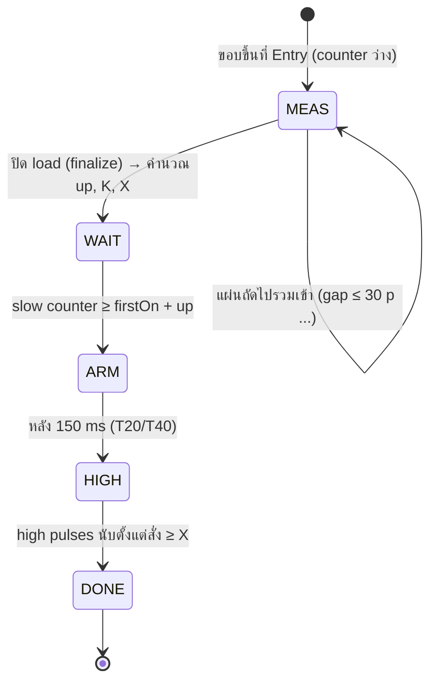

# MIRROR Line — AFT Painting Room: คำอธิบายการทำงานและลอจิกทั้งหมด

> เอกสารนี้อธิบายการทำงานของไลน์ Flow Coater (ห้องพ่นสี Base และ Top) ตามที่จำลองไว้ใน `cloud/public/index.html` (ไฟล์หลัก — เปิดตรงใน browser ได้ หรือ deploy ขึ้น Cloudflare Worker ใน `cloud/`)
> ครอบคลุมตั้งแต่ layout ลูกกลิ้ง, เซนเซอร์, encoder, ลอจิก Siemens (FC0/FC1/FC2–FC5/FC10/FC12), ชั้น Mitsubishi, การเคลือบสี, fault, หน้าจอ และการบันทึกค่า
> ตัวเลขตัวอย่างทั้งหมดคำนวณจาก **layout และพารามิเตอร์ค่าเริ่มต้นที่ฝังอยู่ในไฟล์** (`BAKED_DEFAULT` / `BAKED_PARAMS`) — ถ้าแก้ layout ใน Settings หรือโหลดค่าจาก cloud ตัวเลขจะเปลี่ยนตาม
> ตรวจทานกับ `info/AFT SP MIR-SB03 Book_file_.pdf`, `info/Logic.xlsx`, `info/Glass_size.xlsx` แล้ว (2026-10-20) — สรุปความต่างอยู่ที่ข้อ 23, ข้อค้นพบใหม่ที่ข้อ 21.4 ข้อ 4–6
> ตรวจทานกับโค้ดซิมทั้งไฟล์อีกครั้ง (2026-10-22, commit 9a51502) — layout ค่าเริ่มต้น, ตารางผล, การหยุดไลน์, หน้าจอ และการบันทึกค่า อัปเดตตามโค้ดปัจจุบัน
>
> ⚠ **สถานะตัวเลข:** **ลอจิก** (ลำดับขั้น, เงื่อนไข, สูตร) ยืนยันจาก ladder แล้ว แต่ **ค่าตัวเลขของเครื่องจริงยังรอจดค่าออนไลน์** ตาม `info/PLC_online_checklist.csv` (อ้างเป็น **#เลขข้อ**) — ตัวเลขในตัวอย่าง ตาราง และผลจำลองทั้งหมดใช้ **ค่าปัจจุบันของซิม** (A = 146, Charge Too Long = 470, ความเร็ว 105 / 1240, ramp 0, ความละเอียด 0.3125 / 0.265, layout ประมาณ) ซึ่ง **ไม่ใช่ค่าที่ยืนยันแล้ว** ดูรายการค่าที่รอที่ข้อ 0

---

## 0. ค่าที่ยังรอจดออนไลน์ (อย่าเพิ่งใช้เป็นข้อสรุป)

| ค่าที่ใช้ในเอกสาร / ซิม | ค่าในซิมตอนนี้ | ค่าใน printout (offline) | Checklist |
|---|---|---|---|
| A (speed-up reference) | 146 (counter 2 Top = 150) | 150 ทุกตัว | #1–4 |
| Charge Too Long | 470 | 450 | #11–12 |
| Puls lifting / lowering time, threshold | ไม่จำลอง | T#0MS / 0 | #15–20 |
| T12 run-up Base | 3.0 s | 3.0 s (supplier 1.5 s) | #23 |
| FM350-2 (reset เมื่อ gate เปิด, signal evaluation, gate wiring) | สมมติ reset ที่คำสั่ง, single | — | #29–37 |
| ค่าต่อ load (L, gap, setpoint, K, X) | คำนวณจากสูตร | — | #38–50 |
| ความเร็ว base / high, ramp ของ servo | 105 / 1240 mm/s, 0 s | — | #51–53 |
| Entry sensor I3.1 / I5.1 เป็นตัวไหน | Entry-LEFT | — | #54–55 |
| ความละเอียด encoder slow / high | 0.3125 / 0.265 in/p | — | #56–57 |
| ระยะ layout (ต้น INV, belt, curtain, Inlet, Exit) | ค่าประมาณ | แบบหน้า 6 (เฉพาะบางระยะ) | #58 |
| INV 33M1 ความเร็ว / ramp | = servo | — | #59–61 |
| รายการที่พบเพิ่มจากการ recheck (M8.0, I4.2, I5.6, Q17.x, ตำแหน่งเซนเซอร์ขวาง, load / batch gap, ทิศ 42×32) | — | — | #62–74 (เพิ่มใน checklist แล้ว) |
| E-STOP / การหยุด (สถานะ I2.0, เส้นทางตัด servo 10M1 / 38M1, X ตอน E-STOP, Q14.7 / Q20.7 ค้าง) | ตามผลทดสอบหน้างาน (ข้อ 15.2) | — | #75–80 |

---

## สารบัญ

0. [ค่าที่ยังรอจดออนไลน์](#0-ค่าที่ยังรอจดออนไลน์-อย่าเพิ่งใช้เป็นข้อสรุป)
1. [ภาพรวมของไลน์](#1-ภาพรวมของไลน์)
2. [หน่วย ระบบพิกัด และค่าคงที่](#2-หน่วย-ระบบพิกัด-และค่าคงที่)
3. [Layout ของลูกกลิ้ง และกฎการขับเคลื่อน](#3-layout-ของลูกกลิ้ง-และกฎการขับเคลื่อน)
4. [เซนเซอร์ (Entry / Inlet / Exit)](#4-เซนเซอร์-entry--inlet--exit)
5. [Encoder](#5-encoder)
6. [ขนาดกระจก (Recipe / HMI) และการจัดวางกระจก](#6-ขนาดกระจก-recipe--hmi-และการจัดวางกระจก)
7. [การป้อนกระจกเข้าไลน์ และ Job change](#7-การป้อนกระจกเข้าไลน์-และ-job-change)
8. [ฟิสิกส์การเคลื่อนที่ของกระจก](#8-ฟิสิกส์การเคลื่อนที่ของกระจก)
9. [ลอจิก Siemens — หัวใจของการเร่ง/ลดความเร็ว](#9-ลอจิก-siemens--หัวใจของการเร่งลดความเร็ว)
10. [ตัวอย่างคำนวณทีละขั้น](#10-ตัวอย่างคำนวณทีละขั้น)
11. [การเคลือบสีที่ม่าน (Curtain) และฟิล์มหนา](#11-การเคลือบสีที่ม่าน-curtain-และฟิล์มหนา)
12. [In-room timer](#12-in-room-timer)
13. [สูตรทำนาย (pred) เทียบกับค่าจำลอง (sim)](#13-สูตรทำนาย-pred-เทียบกับค่าจำลอง-sim)
14. [ชั้นความปลอดภัย Mitsubishi (เลือกเปิดได้)](#14-ชั้นความปลอดภัย-mitsubishi-เลือกเปิดได้)
15. [Alarm, E-STOP, Interlock และการจำลอง Fault](#15-alarm-e-stop-interlock-และการจำลอง-fault)
16. [หน้าจอและการใช้งาน](#16-หน้าจอและการใช้งาน)
17. [รายการพารามิเตอร์ทั้งหมด](#17-รายการพารามิเตอร์ทั้งหมด)
18. [การบันทึกค่า / ไฟล์ / ลำดับการโหลดค่า](#18-การบันทึกค่า--ไฟล์--ลำดับการโหลดค่า)
19. [รอบการจำลอง (Simulation loop)](#19-รอบการจำลอง-simulation-loop)
20. [ตารางผลทุกขนาด (ค่าเริ่มต้น)](#20-ตารางผลทุกขนาด-ค่าเริ่มต้น)
21. [ข้อค้นพบ จุดที่ต้องตรวจ และข้อจำกัดของโมเดล](#21-ข้อค้นพบ-จุดที่ต้องตรวจ-และข้อจำกัดของโมเดล)
22. [ไฟล์อ้างอิงในโฟลเดอร์](#22-ไฟล์อ้างอิงในโฟลเดอร์)
23. [ตรวจทานกับเอกสารต้นฉบับ (สรุป)](#23-ตรวจทานกับเอกสารต้นฉบับ-สรุป)

---

## 1. ภาพรวมของไลน์

### 1.1 ลำดับกระบวนการของ MIRROR line

```
Loading → Washing → Chemical → Metal Dry → [Base paint] → Base oven → [Top paint] → Top oven → Recleaning → Unloading
```

ตัวจำลองปัจจุบัน **โฟกัสเฉพาะ Base paint และ Top paint** (ส่วนอื่นอาจเพิ่มในอนาคต) — กระจกที่เข้าห้อง Base มาจาก Metal Dry, กระจกที่เข้าห้อง Top มาจาก Base oven / Base paint cooling (ผ่าน Cross Over Table Inlet = INV 33M1)

> หมายเหตุ: ใน Siemens FC12 มีเซนเซอร์ **Loading sensor I6.4** ที่วัดความยาวกระจกตั้งแต่ส่วน Loading แล้วเทียบกับ Entry ห้อง Top (ดูข้อ 9.8) — เป็นจุดเชื่อมกับส่วน Loading ถ้าจะขยายตัวจำลองในอนาคต

### 1.2 ห้องพ่นสี

กระจกไหลจาก **เตาอบ / metal dry → ห้องพ่นสี → เตาอบ** (ซ้าย → ขวา บนจอ) มีห้องพ่น 2 ห้องที่ลอจิกเหมือนกันแต่ layout ต่างกัน:

| ห้อง | สีสี (บนจอ) | ลักษณะ |
|---|---|---|
| **Base paint room** | ส้ม `#FF7032` | ไม่มี INV roller — มีแต่สายพาน 2 ความเร็ว 2 เส้น |
| **Top paint room** | ฟ้าเทา `#7EA6B4` | มี **INV roller** 8 ลูก (Mitsubishi inverter 33M1) ก่อนสายพาน 2 เส้น |

หลักการ: กระจกเดินด้วย **ความเร็วต่ำ (base) 105 mm/s** บนโซ่ เมื่อกระจกทั้งชุดขึ้นไปอยู่บนองค์ประกอบ 2 ความเร็ว (INV roller / สายพาน) แล้ว PLC สั่ง **ความเร็วสูง (high) 1240 mm/s** ให้กระจกวิ่งผ่าน **ม่านสี (curtain)** ด้วยความเร็วสูง เพื่อให้ได้ฟิล์มบางตามสเปก จากนั้นสั่ง **กลับ base** ก่อนถึงทางออก

ถ้ากระจกส่วนใดผ่านม่านตอนที่ห้องยังเป็นความเร็ว base → สีที่ได้หนากว่าปกติ ≈ 1240/105 = **11.8 เท่า** (ฟิล์มหนา)

```
 ← จากเตา                                 ห้องพ่น                                     ไปเตา →
 ┌──────────┬────┬──────────┬──────────────┬────────────┬──────────────────┬────────┬────┬──────────┐
 │  chain   │head│  free    │ INV (top)    │  belt 1    │ CURTAIN  belt 2  │ free   │head│  chain   │
 │ (base)   │    │ rollers  │ (2-speed)    │ (2-speed)  │    ┃             │rollers │    │ (base)   │
 └──────────┴────┴──────────┴──────────────┴────────────┴────┃─────────────┴────────┴────┴──────────┘
            ENTRY(0)                     INLET                ┃                     EXIT
            วัดความยาว                    เข้าห้อง              ม่านสี                 ออกห้อง
```

ตัวควบคุม:

- **Siemens S7 PLC** — วัดความยาวกระจก, คำนวณจุดเร่ง/จุดลด, สั่ง servo Lenze (และ INV 33M1 ในห้อง Top), ตรวจ run-up / retardation / Charge Too Long
- **Mitsubishi PLC** — ชั้นตรวจความปลอดภัยเพิ่มเติม (เทียบความยาว, ตรวจ lane, ตรวจคู่เซนเซอร์, จับเวลา Inlet→Exit) — ในโปรแกรมจำลองปิดไว้เป็นค่าเริ่มต้น
- **Siemens FC12 Network 24–74 (“Sawang modify”)** — ชั้นตรวจที่ **มีอยู่แล้วใน Siemens** (ห้อง Top เป็นหลัก): เทียบความยาว Load / Entry / Exit, Glass too long 465 p, ตรวจคู่เซนเซอร์ Entry, Glass delay 10 s — ดูข้อ 9.8 (ยังไม่ได้จำลอง)

### 1.3 อุปกรณ์หลัก (จาก AFT SP MIR-SB03 Book หน้า 5–6)

| Mark | DWG | อุปกรณ์ | ห้อง |
|---|---|---|---|
| En1 | 48B1 | Slow encoder 32 p/rev (Impulsegeber – Längenmessung) | Base |
| En2 | 45B7 | High encoder 68 p/rev (curtain coater base paint) | Base |
| En3 | 50B1 | Slow encoder 32 p/rev (curtain coater no.2) — input **I5.0** | Top |
| En4 | 46B7 | High encoder 68 p/rev (curtain coater top paint) | Top |
| SM1 | 10M1 | Servo Lenze — C/V #1 belt ห้อง Base | Base |
| M8 | 31M1 | Base Paint Oven transport (DOL) — C/V #2 | — |
| M9 | 33M1 | Cross Over Table Inlet — **Mitsubishi inverter** (= INV roller) C/V #3 | Top |
| SM11 | 38M1 | Servo Lenze — C/V #4 belt ห้อง Top | Top |
| PH1 | I3.1 (I2.6 OR) | Entry sensor BP (Main) | Base |
| PH3 | I5.1 (I5.2 OR) | Entry sensor TP (Main) | Top |

---

## 2. หน่วย ระบบพิกัด และค่าคงที่

### 2.1 ระบบพิกัด

- **แนวไหล (x)**: ตำแหน่งทั้งหมดอ้างอิง **Entry sensor = 0** ค่า + = ไปทางปลายน้ำ (ขวา) ค่า − = ต้นน้ำ
  - บนจอแสดงเป็น **mm** แต่ภายในโปรแกรมคำนวณเป็น **inch** (1 in = 25.4 mm)
  - “ตำแหน่งของกระจก” = ตำแหน่ง **ขอบหน้า (front)** ของกระจก เว้นแต่ระบุว่า tail (ขอบหลัง)
- **แนวขวาง (y)**: หน่วย inch, 0 = เส้นกึ่งกลางลูกกลิ้ง, ค่าลบ = ด้าน **LEFT** (เมื่อหันหน้าตามทิศไหล)
- “vs Inlet / vs Exit”: + = เลยเซนเซอร์ไปแล้ว, − = ยังไม่ถึง

### 2.2 หน่วยพัลส์

| ชื่อ | ความละเอียด | ใช้กับ |
|---|---|---|
| **slow pulse (p / sp)** | 0.3125 in = **7.94 mm** / pulse (encoder 32 p/rev) | วัดความยาวกระจก, setpoint จุดเร่ง (A, Gₛ, K) — หมุนตามโซ่ (ความเร็ว base) ตลอด |
| **high pulse (hp)** | 0.265 in = **6.73 mm** / pulse (encoder 68 p/rev) | ระยะความเร็วสูง X — หมุนตามความเร็วห้อง (servo) |

### 2.3 ความเร็ว

> ค่า 105 / 1240 mm/s และ ramp 0 s เป็นค่าในซิม — ค่าจริงของ Lenze รอ #51–53, INV 33M1 รอ #59–61

| ค่า | mm/s | in/s | slow p/s | high p/s |
|---|---|---|---|---|
| base | 105 | 4.134 | 13.2 | 15.6 |
| high | 1240 | 48.82 | — | 184.2 |

การเปลี่ยนความเร็ว base ↔ high = **ทันที** (ramp 0 s เป็นค่าเริ่มต้น ปรับได้)

---

## 3. Layout ของลูกกลิ้ง และกฎการขับเคลื่อน

### 3.1 ชนิดองค์ประกอบ (Types)

| ชนิด | สีบนจอ | การขับ (drive) | ความหมาย |
|---|---|---|---|
| Chain conveyor | เหลือง | `base` | โซ่ — ความเร็ว base เสมอ (หยุดเมื่อไลน์หยุด) |
| Chain head | ชมพู | `base` | หัวโซ่ — base |
| Normal roller | เขียวอมฟ้า | `base` | ลูกกลิ้งขับ — base |
| Free roller | เทา | `free` | ลูกกลิ้งฟรี ไม่มีแรงขับ |
| New free roller | น้ำเงิน | `free` | ลูกกลิ้งฟรีที่เพิ่มใหม่ |
| INV roller (2-speed) | ม่วง | `room` | ลูกกลิ้ง inverter — ตามความเร็วห้อง (เฉพาะห้อง Top) |
| Belt (2-speed) | เขียว | `room` | สายพาน — ตามความเร็วห้อง |

### 3.2 กฎการขับกระจก (Drive rule) — `driveAt(tail, front)`

ทุก step โปรแกรมคำนวณว่ากระจกแต่ละแผ่น “แตะ” โซน `room` และโซน `base` ยาวเท่าไร (ความยาวที่ซ้อนทับ):

1. แตะเฉพาะ free roller → **`free`**: กระจก **คงความเร็วเดิม** ที่มีอยู่ (เช่นออกจากสายพานตอน high ก็ยังวิ่ง high ต่อบน free roller จนไปแตะ chain/head)
2. แตะ `room` อย่างเดียว (± free) → วิ่งด้วย **ความเร็วห้อง** (base หรือ high ตามคำสั่ง)
3. แตะ `base` อย่างเดียว (± free) → วิ่ง **base**
4. แตะทั้ง `room` และ `base` พร้อมกัน → ตามพารามิเตอร์ **`mixDrive`** (Settings → Glass & speed → Glass):
   - `more` (**ค่าเริ่มต้น**): ตามฝั่งที่แตะยาวกว่า — เป็นหลักฟิสิกส์ ไม่เกี่ยวกับ PLC: กระจกหนาเท่ากันตลอดแผ่น ฝั่งที่แตะยาวกว่ารับน้ำหนักมากกว่า → แรงเสียดทานมากกว่า → ลากกระจกไปได้ (แบบง่าย ไม่คิดการลื่น / ความเร่ง)
   - `room`: ตามองค์ประกอบ 2 ความเร็ว (ค่าเริ่มต้นเดิม)
   - `base`: ตามโซ่

> ค่านี้สำคัญ: ตัดสินว่าแผ่นท้ายของ load ก่อนหน้าที่ยังค้างบน belt 2 ครึ่งหนึ่ง จะถูก “กระชาก” ไปชนแผ่นข้างหน้าหรือไม่เมื่อ load ถัดไปเร่ง

ลูกกลิ้งบนจอ: ถ้าหมุน → มีลายเส้นเลื่อน (ความถี่ ∝ √ความเร็ว) และขอบสีส้ม (base) / ฟ้า (high); ถ้าหยุด → สีจาง free roller จะหมุนก็ต่อเมื่อมีกระจกที่กำลังเคลื่อนทับอยู่

### 3.3 Layout ค่าเริ่มต้น — ห้อง **Top** (mm จาก Entry)

| # | ชนิด | จำนวน × Ø, pitch / ยาว | ② ถึงแถวถัดไป (c-c) | เริ่ม | สิ้นสุด |
|---|---|---|---|---|---|
| 1 | Chain | 5 × Ø63, pitch 254 | 200 | −1324 | −245 |
| 2 | Chain head | 1 × Ø63 | 265 | −108 | −45 |
| 3 | Free roller | 3 × Ø80, pitch 292.1 | 300 | 149 | 813 |
| 4 | **INV roller** | 8 × Ø100, pitch 300 | 190 | 1023 | 3223 |
| 5 | **Belt 1** | ยาว 1600 | 260 | 3363 | 4963 |
| 6 | **Belt 2** | ยาว 3640 | 260 | 5223 | 8863 |
| 7 | Free roller | 5 × Ø80, pitch 160 | 160 | 9083 | 9803 |
| 8 | New free roller | 1 × Ø80 | 160 | 9883 | 9963 |
| 9 | Chain head | 1 × Ø63 | 200 | 10051 | 10114 |
| 10 | Chain | 4 × Ø63, pitch 254 | — | 10251 | 11076 |

จุดสำคัญ (Top): **Entry 0 · Inlet 3313 · Curtain 5093 · Exit 10003** · ผนังห้อง 2423 → 10664 · A (146 p) = 1159 mm
(Entry = ปลายหัวโซ่ #2 + 45 mm, Inlet = ปลาย INV #4 + 90 mm, Exit = ปลาย new free roller #8 + 40 mm)

### 3.4 Layout ค่าเริ่มต้น — ห้อง **Base**

| # | ชนิด | จำนวน × Ø, pitch / ยาว | ② ถึงแถวถัดไป | เริ่ม | สิ้นสุด |
|---|---|---|---|---|---|
| 1 | **Normal roller** (ขับ base) | 6 × Ø63, pitch 254 | 254 | −1248 | 85 |
| 2 | Free roller | 4 × Ø78, pitch 304.8 | 188 | 269 | 1261 |
| 3 | **Belt 1** | ยาว 3645 | 165 | 1410 | 5055 |
| 4 | **Belt 2** | ยาว 3620 | 171 | 5220 | 8840 |
| 5 | Free roller | 5 × Ø78, pitch 130 | 240 | 8972 | 9570 |
| 6 | Chain head | 1 × Ø78 | 305 | 9732 | 9810 |
| 7 | Chain | 6 × Ø78, pitch 305 | — | 10037 | 11640 |

จุดสำคัญ (Base): **Entry 0 · Inlet 668 · Curtain 5137 · Exit 9650** · ผนังห้อง 269 → 10310 (Exit ห้อง Base เป็นค่าประมาณ/placeholder — บนจอเขียน “EXIT (placeholder)”)
(Entry = ปลาย normal roller #1 − 85 mm, Inlet = ต้น free roller #2 + 400 mm, Exit = ปลาย free roller #5 + 80 mm)

> Layout ทั้งสองห้องเป็น **ค่าประมาณแรกจาก `position_sensor.pdf`** ต้องวัดจริงและแก้ใน Settings → Line layout (หรือลากบนภาพ Line preview)
> ค่าในตารางคือ `BAKED_DEFAULT` ที่ฝังในไฟล์ — เมื่อเปิดผ่าน Worker ซิมจะโหลด **cloud default** แทน (ข้อ 18) ซึ่งอาจต่างจากตารางนี้ ส่วน `DEFAULT_LAYOUT` ในโค้ด (ค่าจากแบบรุ่นแรก) ใช้เมื่อไม่มีค่าอื่นเลยเท่านั้น

### 3.4.1 เทียบกับแบบ “SB03 C/V drive” (Book หน้า 6)

แบบแสดงระยะออกแบบของทั้งสองห้อง (นับจาก Entry photo sensor):

| ระยะ | Base (แบบ) | Base (ซิม) | Top (แบบ) | Top (ซิม) |
|---|---|---|---|---|
| Entry → จุด A / ต้น C/V 2 ความเร็ว | 45.6 in = **1159 mm** (A = 146 p) | belt 1 เริ่ม 1410 | 45.6 in = **1159 mm** (ต้น C/V #3 INV) | INV เริ่ม **1023** |
| จุด A → curtain | 152 in | — | 144.5 in | — |
| **Entry → curtain** | 197.6 in = **5019 mm** | 5137 (ต่าง +118) | 190.1 in = **4829 mm** | 5093 (**ต่าง +264**) |
| curtain → ปลาย C/V 2 ความเร็ว | 144 in | — | 144 in | — |
| จุด A → ปลาย C/V 2 ความเร็ว | 296 in (≈ “1110 pls”) | — | 288.5 in (≈ “1110 pls”) | — |
| **Entry → ปลาย C/V 2 ความเร็ว** | 341.6 in = **8677 mm** | 8840 (ต่าง +163) | 334.1 in = **8486 mm** | 8863 (**ต่าง +377**) |
| ปลาย C/V → ถัดไป | 29.5 in | — | 29.5 in | — |

ข้อสังเกต (ตีความ — ยังไม่ยืนยัน): ในแบบ ป้าย “1110pls” อยู่ใต้ช่วงเดียวกับ 296 / 288.5 in และ 1110 × 0.265 = 294 in ใกล้กับระยะนั้น จึง **อาจ** หมายถึงความยาวจากจุด A ถึงปลาย conveyor 2 ความเร็ว — ขึ้นกับความละเอียด high encoder จริง (#57) และ FM350 signal evaluation (#36)

- ห้อง Base ซิมเลื่อนไปทางขวา ~120–160 mm (curtain / ปลายสายพาน) และต้นสายพานช้ากว่าแบบ 251 mm (ซิม 1410 vs แบบ 1159)
- ห้อง Top ซิมเลื่อนไปทางขวา ~260–380 mm ที่ curtain และปลายสายพาน แต่ INV เริ่มก่อนแบบ 136 mm — **จุดเริ่ม INV มีผลมาก** กับปัญหากระจกแผ่นถัดไปถูกดึง (ข้อ 21.4)
- ในแบบเดิมมีเซนเซอร์เฉพาะที่ Entry (Inlet / Exit เป็นเซนเซอร์ใหม่ของชั้น Mitsubishi / Sawang)

### 3.5 โมเดลของ Layout editor

- 1 แถว = กลุ่มลูกกลิ้งชนิดเดียวกัน เรียงตามทิศไหล
  - ลูกกลิ้ง: `qty`, `dia` (Ø), `pitch` (① c-c ระหว่างลูกในแถว) → ความกว้างแถว = (qty−1)·pitch + Ø
  - สายพาน: `len`
- **② To next row (`next`)** = ระยะจาก **กึ่งกลางลูกสุดท้าย** ของแถวนี้ ถึง **กึ่งกลางลูกแรก** ของแถวถัดไป (สายพานนับจากขอบ) — แถวสุดท้ายไม่มี ②
  - ตำแหน่งแถวถัดไป = (ปลายแถวนี้ − Ø/2) + next − (Ø แถวถัดไป/2)
  - แก้ค่าใดก็ตาม แถวที่ตามมาทั้งหมดจะถูกดันตาม
  - ② สีแดง = แถวนี้ซ้อนทับแถวถัดไป
- **เซนเซอร์และผนังห้องผูกกับแถว**: ตำแหน่ง = ขอบ (upstream/downstream) ของแถวที่เลือก + offset (+ = ไปทางขวา)
  - หลังคำนวณทั้งหมด พิกัดทั้งเส้นถูกเลื่อนให้ **Entry = 0** เสมอ
  - ผนังห้อง (wallIn / wallOut) ใช้วาดอย่างเดียว ไม่มีผลต่อการเคลื่อนที่
- **Curtain**: **เสมอ** = กึ่งกลางช่องว่างระหว่าง belt 1 กับ belt 2 (ถ้ามีสายพานเส้นเดียว = กึ่งกลางสายพาน) — ค่า curtain ที่เคยบันทึกเองในไฟล์เก่าถูกเพิกเฉย
- ปุ่มในแต่ละแถว: ↑ ↓ (สลับลำดับ — ค่า ② อยู่กับ “ช่อง” ไม่ย้ายตามแถว), ＋ (แทรกสำเนาต่อท้ายแถวนี้), ✕ (ลบ — เซนเซอร์ที่ผูกกับแถวนั้นจะถูกผูกใหม่กับแถวข้างเคียงโดยคงตำแหน่งเดิม)
- ◆ ใต้ชื่อชนิด = มีเซนเซอร์/ผนังผูกอยู่กับแถวนั้น; คอลัมน์ “Where it sits on the line” = แถบตำแหน่งของแถวเทียบทั้งเส้น มีขีด Entry / Inlet / Exit
- ช่วงค่าที่รับ: qty 1–200, Ø 1–1000, pitch 0–5000, len 1–50000, ② −50000…50000 mm (นอกช่วง → ตัดให้อยู่ในช่วงพร้อมแจ้ง); ช่องว่าง / ไม่ใช่ตัวเลข → คงค่าเดิม
- **แก้บนภาพ (Line preview)**: ลาก Inlet / Exit, ผนังห้อง, คู่เซนเซอร์ L / C / R (แนวขวาง), แถว (เปลี่ยน ② ของแถวก่อนหน้า — แถวแรกลากไม่ได้), ปลายสายพาน (เปลี่ยนความยาว) และขอบความกว้างลูกกลิ้ง / สายพาน; คลิกชิ้นส่วน = กล่องใส่ค่า mm ตรง ๆ; คลิกที่ว่าง = ย้ายกระจกตัวอย่าง; **Shift** = ทีละ 10 mm, **Esc** = ยกเลิกการลาก
- **Undo / Redo** ทุกการแก้ layout + parameters (ทั้งสองห้อง) สูงสุด 100 ขั้น — ปุ่ม ↶ ↷ หรือ Ctrl+Z / Ctrl+Y (Ctrl+Shift+Z) ในหน้า Settings
- ช่องที่ต่างจาก Save ล่าสุดเป็น **สีเหลือง** และแท็บที่มีช่องเหลืองมีจุดเตือน “Has changes not saved yet”
- ตรวจ layout อัตโนมัติ (pop-up): มีสายพาน < 2 เส้น (curtain วางไม่ได้ตามหลัก), Exit ไม่อยู่หลัง Inlet, curtain อยู่นอกช่วง Inlet → Exit
- รองรับไฟล์ layout รูปแบบเก่า: v1 (ตำแหน่ง start แบบสัมบูรณ์), v2 (anchor + anchorStart), v3 (ผูกเซนเซอร์กับแถว — ปัจจุบัน) — ค่า `gap` (ขอบถึงขอบ) แบบเก่าถูกแปลงเป็น `next` (c-c) อัตโนมัติ

---

## 4. เซนเซอร์ (Entry / Inlet / Exit)

### 4.1 ตำแหน่ง

มี 3 ตำแหน่งตามแนวไหล × 3 section ตามแนวขวาง × คู่ละ 2 ตัว (A/B) = **18 ตัว**

| ตำแหน่ง | หน้าที่ |
|---|---|
| **ENTRY** (x = 0) | Siemens วัดความยาวกระจก (FC2–FC5); Mitsubishi วัดความยาวเทียบ recipe |
| **INLET** | จุดเข้าห้อง — เริ่ม In-room timer / Mitsubishi speed-up timer |
| **EXIT** | จุดออกห้อง — หยุด timer / Mitsubishi เทียบความยาวรอบสอง |

### 4.2 Section ตามแนวขวาง (ค่าเริ่มต้น)

- ความกว้างลูกกลิ้ง **2750 mm** → ครึ่งหนึ่ง 54.13 in (`rollerWidthMM`); สายพานกว้าง **2650 mm** เส้นกึ่งกลางเดียวกัน (`beltWidthMM` — ใช้วาดเท่านั้น)
- ขอบซ้ายของกระจก (loading reference) ห่างขอบซ้ายลูกกลิ้ง 100 mm → y = **−50.20 in**
- ตำแหน่งเซนเซอร์ **B** (ตัวขวาของคู่) วัดจากขอบซ้ายกระจก: **L = 20 in, C = 52 in, R = 82 in** — ในหน้า Settings → Sensors พิมพ์เป็น mm ได้ทั้ง “จากขอบซ้ายกระจก” หรือ “จากขอบซ้ายลูกกลิ้ง” (`sensRef`) แต่เก็บเป็น inch จากขอบกระจกเสมอ
  - ⚠ `Glass_size.xlsx` (sheet “Batch 2”) ระบุ **sensor 1 = 22 in** (56 cm), sensor 2 = 52 in (133 cm), sensor 3 = 82 in (209 cm) “from Left” — **ซิมใช้ 20 in สำหรับ L ต่างจากเอกสาร 2 in** และเอกสารไม่ระบุว่าวัดถึงเซนเซอร์ตัวไหนของคู่ (A / B / กึ่งกลาง)
- เซนเซอร์ **A** (ตัวซ้ายของคู่) อยู่ซ้ายของ B ไป 100 mm (3.94 in)

| Section | y ของ A (in) | y ของ B (in) |
|---|---|---|
| 1 LEFT | −34.13 | −30.20 |
| 2 CENTER | −2.13 | +1.80 |
| 3 RIGHT | +27.87 | +31.80 |

### 4.3 เงื่อนไขเซนเซอร์ ON

เซนเซอร์ตัวหนึ่ง ON เมื่อมีกระจกแผ่นใดที่ `front ≥ x_sensor > tail` **และ** ในแนวขวาง `y0 + covMargin ≤ y_sensor ≤ y1 − covMargin` (covMargin = 1 in — ต้องมีกระจกเลยลำแสงอย่างน้อย 1 นิ้ว) และเซนเซอร์นั้นไม่ได้ถูกตั้ง fault “stuck OFF”

### 4.4 “Sensors ON” ต่อขนาด

แต่ละขนาดในรายการผลิตกำหนดว่า section ไหนเปิดใช้ (`'123'` = L C R, `'13'` = L R, `'12'` = L C)
- ใช้กับชั้น Mitsubishi และการแสดงผล (section ที่ปิดจะจางลง / ปุ่มเส้นประ)
- โปรแกรมคำนวณ `coverage()` ว่ากระจกจริง ๆ คลุมคู่เซนเซอร์ใดได้ **ทั้ง A และ B** แล้วเทียบกับรายการผลิต: “✓ glass covers them all” หรือ “✗ glass does not cover …”
- ขนาด Custom → Sensors ON = ผลของ `coverage()`

จาก `Glass_size.xlsx` (sheet “Size”) — การเลือก section ใน Mitsubishi:

| กลุ่ม | Sensors ON | M-bit |
|---|---|---|
| Batch | 1, 2, 3 | M1030 |
| Batch | 1, 2 | M1031 |
| Batch | 1, 3 | M1032 |
| Single | 1, 2 | M1033 |
| Single | 1, 2, 3 | M1034 |

- กฎสำหรับ single ตามความกว้าง: **1–56 in → ON 1**, **56–80 in → ON 1, 2**, **> 80 in → ON 1, 2, 3**
- ค่า register (บันทึก 20260910): ON 1,2 = **15**, ON 1,3 = **51**, ON 1,2,3 = **63** = bit mask 6 บิตของคู่เซนเซอร์ (L A/B = bit 0–1, C = bit 2–3, R = bit 4–5)
- รายการผลิต 26 ขนาดใน sheet “Size” **ตรงกับ preset ในซิมทุกขนาด** (รวม tag Mu = Murakami, “Cos หลังขาว” = Cosmetic-White)

### 4.5 Address เซนเซอร์ใน Siemens (จาก ladder)

| สัญญาณ | Base (BP) | Top (TP) |
|---|---|---|
| Entry (Main — ใช้วัดความยาว FC2–FC5) | **I3.1** | **I5.1** |
| Entry No.1 / No.2 (double check, FC12 Sawang) | I2.6 / I5.3 | I5.4 / I5.2 |
| Slow encoder pulse | I3.0 | I5.0 |
| “Entry Curtain Top-paint” (ใช้เป็นจุดเริ่ม Glass delay) | — | **I4.2** |
| Exit sensor | — | **I5.6** |
| Loading sensor | — | I6.4 |

---

## 5. Encoder

| Encoder | นับอะไร | สูตรต่อ step |
|---|---|---|
| **Slow enc #1** (`s1`) | ความเร็วโซ่ (base) / 0.3125 in | Siemens ใช้วัดความยาวและนับถึงจุดเร่ง; Mitsubishi ใช้ที่ Entry |
| **Slow enc #2** (`s2`) | เหมือน #1 | Mitsubishi ใช้ที่ Exit |
| **High enc** (`h`) | ความเร็วห้อง / 0.265 in (FM350-2) | Siemens นับระยะ X; ตรวจ run-up (≥ 100 hp) |
| `hRate` | อัตรา high pulse กรองด้วย time constant 0.12 s | ใช้ตรวจ retardation และแสดงความเร็ว feedback |

- slow encoder หมุน **ตลอดเวลาที่ไลน์เดิน** (ที่ base) ไม่ขึ้นกับความเร็วห้อง → ระยะใน slow pulse = ระยะที่กระจกเดินบนโซ่
- high encoder หมุนตามความเร็วห้อง แม้ตอน base ก็นับ (~15.6 hp/s)
- High counter **เริ่มนับ X ตั้งแต่ตอนคำสั่ง speed-up** (`hAt = enc.h` ณ วินาทีสั่ง) — ในเครื่องจริงต้องตรวจว่า FM350 รีเซ็ตเมื่อ Q14.7 / Q20.7 ON หรือไม่ (ดู checklist ข้อ 29–37)

---

## 6. ขนาดกระจก (Recipe / HMI) และการจัดวางกระจก

### 6.1 รายการผลิต (Presets)

**Batch sizes** (W×L นิ้ว · across×in-flow · sensors ON):

| ขนาด | Across × In flow | Sensors | Tag |
|---|---|---|---|
| B 24×36 | 4 × 3 | L C R | |
| B 30×50 | 3 × 2 | L C R | |
| B 30×60 | 3 × 1 | L C R | Murakami |
| B 30×54.5 | 3 × 1 | L C R | Murakami |
| B 36×60 | 2 × 1 | L C | |
| B 36×72 | 2 × 1 | L C | |
| B 42×32 | 2 × 3 | L R | |
| B 42×72 | 2 × 1 | L R | |
| B 43×49 | 2 × 2 | L R | Cosmetic- White |
| B 43×65 | 2 × 1 | L R | |
| B 48×36 | 2 × 3 | L R | |
| B 48×60 | 2 × 1 | L R | |
| B 48×72 | 2 × 1 | L R | |

**Single sizes** (1 × 1): S 60×120 (L C), S 72×120 (L C), S 84×126, S 84×60, S 84×72, S 84×84, S 84×120, S 84×144, S 96×60, S 96×72, S 96×84, S 96×120, S 96×144 (ทั้งหมด L C R)

ค่าเริ่มต้นเมื่อเปิดโปรแกรม: **S 84×120** (ขนาดที่ผลิตมากที่สุดใน `Glass_size.xlsx` › Size Insight)

ประวัติการผลิตจาก `Glass_size.xlsx` sheet “Size Insight” (230 jobs: จำนวน job, Exp.prod.time, Loss time, ความหนา, type, สี) ฝังไว้ในโค้ด (`HIST`) — ใช้แสดงใน Master table มุมมอง Production และการ์ด Production history (ข้อ 16.4)

### 6.1.1 Standard loading gap (`Glass_size.xlsx` sheet “0.Std.Loading gap”)

ชีตนี้แปลงความยาวเป็นพัลส์ด้วย 25.4/7.92 (= 7.92 mm/p ใกล้กับ slow pulse 0.3125 in = 7.94 mm — ค่าจริงรอ #56)

| ขนาด (L flow × W cross, in) | pcs/row × rows | Gap X (in, ขวาง) | **Gap Y (in, ระหว่าง load)** |
|---|---|---|---|
| Batch 36 × 24 | 4 × 3 | 1 | 10 |
| Batch **42 × 32** | **3 × 2** | 0 | **4** |
| Batch 36 × 48 | 2 × 3 | 1 | 10 |
| Batch 43 × 49 (ระบุ flow 43, cross 49) | 2 × 2 | 1 | 10 |
| Batch 50 × 30 | 3 × 2 | 0 | 10 |
| 60 × 30 / 60 × 36 / 60 × 48 / 65 × 43 | 3 / 2 / 2 / 2 × 1 | 0 | **4** |
| 72 × 42 / 72 × 48 | 2 × 1 | 0 | **2** |
| 60 × 84 / 60 × 96 (L 60) | 1 × 1 | 0 | 4 |
| 72 × 84, 84 × 84, 72 × 96, 84 × 96 | 1 × 1 | 0 | **2** |
| 120 × 60 / 72 / 84 | 1 × 1 | 0 | 2 |
| 120 × 96, 144 × 84, 144 × 96 | 1 × 1 | 0 | **118** |
| Murakami 1385 × 775 mm, 1540 × 775 mm (54.5 / 60.6 × 30.5 in) | 3 × 1 | 0 | 4 |

`Logic.xlsx`: “Single → gap between loads 2–4 in · Batch → gap between sheets 2–3 in, between loads 10 in”

ข้อแตกต่างกับซิม:
- **ซิมใช้ Load gap 10 in กับทุกขนาด** แต่มาตรฐานจริงของ single คือ **2–4 in** (และ 42×32 = 4 in) — ผลจำลองด้วย gap จริงดูข้อ 21.4
- **Batch gap ในซิม 2 in** ทั้งตามแนวไหล (Batch flow) และแนวขวาง (Batch across) — `Logic.xlsx` บอก 2–3 in, แผนภาพ Book หน้า 9 ใช้ 1.9 in, ค่าที่ค้างใน DB9 (ข้อ 9.7) = 11 p — ค่าจริงรอจด (#71)
- **ทิศของ 42×32 ขัดกัน**: sheet “Size” / ซิม = W 42 × L 32, 2 across × 3 in flow; sheet “Std.Loading gap” = flow 42 × cross 32, **3 across × 2 in flow** (49×43 ก็ระบุ cross 49 / flow 43 ขัดกับ sheet “Size” ที่ W 43 × L 49)
- 24×36 · 4 across: เอกสารใช้ Gap X 1 in → 4×24 + 3 = 99 in > 96; ซิม (Batch across 2 in) = **102 in > 96** → ซิม**ไม่บีบช่องว่างแล้ว** แต่ขึ้นเตือน “Wider than the max glass width” (ข้อ 6.3)
- Murakami กว้างจริง 775 mm = 30.5 in (ซิมใช้ 30)

### 6.2 ช่อง HMI size

| กลุ่ม | ช่อง | ความหมาย |
|---|---|---|
| Sheet | Width (in) | ความกว้างแผ่น (แนวขวาง) |
| | Length (in) | ความยาวแผ่น (แนวไหล) |
| | Loads (0 = ∞) | จำนวน load ที่จะป้อน — **มีผลทันที** ไม่ต้อง Confirm |
| Batch layout | Across | จำนวนแผ่นเรียงขวาง |
| | In flow | จำนวนแผ่นเรียงตามแนวไหล |
| | Alignment | Left ref (ชิดขอบซ้าย) / Centered (กึ่งกลางลูกกลิ้ง) / Split L/R (กระจายเต็ม max glass width 96 in) |
| Gaps | Batch flow (in) | ช่องว่างระหว่างแผ่น **ภายใน load** ตามแนวไหล (`gapX`, ค่าเริ่มต้น 2 in) — แสดงเฉพาะเมื่อ Across > 1 หรือ In flow > 1 |
| | Batch across (in) | ช่องว่างระหว่างแผ่นตามแนวขวาง (`gapA`, ค่าเริ่มต้น 2 in) — แสดงเฉพาะ batch เช่นกัน |
| | Load (in) | ช่องว่างระหว่าง **load** (`gapY`, ค่าเริ่มต้น 10 in) |
| Job | Job change (min) | เวลาหยุดป้อนกระจกหลัง Confirm ขนาดใหม่ (ค่าเริ่มต้น 1 min) |

- เปลี่ยนค่าใดใน W / L / In flow / Across / Alignment → dropdown กลายเป็น “Custom…” (Custom: Sensors ON = ผล `coverage()`)
- แถบ **L / C / R** ใต้ dropdown แสดง section ที่ขนาดในฟอร์มจะเปิด (ON / OFF) และ “was …” ถ้าต่างจากขนาดที่กำลังผลิต
- ปุ่ม **Confirm (send to PLC)** กดได้เฉพาะเมื่อขนาดต่างจากที่กำลังผลิต (เทียบ W, L, Across, In flow, Alignment, Batch flow, Batch across, Load gap) — ถ้าไม่ต่างจะขึ้น “Size unchanged”; ปุ่ม **Cancel** = คืนฟอร์มเป็นขนาดที่กำลังผลิต (ไม่ส่งอะไร)
- **ตรวจขนาด (`sizeChecks`)** — แสดงในแผง HMI และเป็น pop-up เมื่อแก้ช่อง / กด Confirm:

| ตรวจ | ระดับ |
|---|---|
| กระจกเลยขอบลูกกลิ้ง (Glass hangs off the rollers) | bad |
| กว้างรวม `n·W + (n−1)·gapA` > max glass width 96 in | bad |
| ความยาว load > Charge Too Long (`chargeLong`) / เหลือ margin < 40 p | bad / wrn |
| ความเร็วสูงคลุม curtain < 99.5 % (บอกว่าเร่งหลัง curtain หรือกลับ base ก่อน tail ผ่าน) | < 80 % bad, อื่น ๆ wrn |
| ไม่คลุมคู่เซนเซอร์ใดเลย / ไม่คลุมคู่ Entry-LEFT (เมื่อ `siemensEntry = left` → ไม่มีการเร่ง) | bad |
| section ที่ HMI เปิด แต่กระจกไม่คลุม | wrn |
| PLC รู้ L ช้า (late) | info (แสดงในแผงเท่านั้น) |

- ความยาว load สุทธิ: `lNet = nLen·L + (nLen−1)·gapX`

### 6.3 การจัดวางแนวขวาง — `lateral()`

- ช่องว่างขวางระหว่างแผ่น = **`gapA` ตามที่ตั้ง (ค่าเริ่มต้น 2 in) เสมอ** — **ไม่บีบ**ให้พอดี 96 in อีกต่อไป; ถ้ากว้างรวมเกิน max glass width จะขึ้นเตือนใน `sizeChecks` แทน (เช่น 24×4 = 96 + 3×2 = **102 in**)
- Split L/R: ช่องว่าง = (96 − n·W)/(n−1) — กระจายเต็ม max glass width
- Centered: เริ่มที่ −(n·W + (n−1)·gap)/2
- Left ref: เริ่มที่ขอบอ้างอิงซ้าย y = −50.20 in

---

## 7. การป้อนกระจกเข้าไลน์ และ Job change

### 7.1 Spawn (ทุก step)

1. ถ้า `Loads > 0` และป้อนครบแล้ว → หยุดป้อน
2. ถ้ากำลัง Job change → ไม่ป้อน
3. Load แรกเกิดที่ front = ขอบซ้ายของภาพ − 30 in (ห้อง Top ≈ −2221 mm)
4. Load ถัดไป: เกิดเมื่อ `tail ของ load ก่อน − Load gap` เลื่อนเข้ามาถึงจุดเกิด → front = `min(จุดเกิด, tail − Load gap)` → ระยะห่างระหว่าง load = **Load gap** เสมอ (ถ้าเคยหยุดไป ก็เริ่มใหม่ที่จุดเกิด)
5. สร้างแผ่นทั้งหมดของ load: แผ่นแถว `row` อยู่ที่ `front − row·(L + gapX)` แต่ละแผ่นเก็บ lane (y0, y1), ความเร็ว, อาร์เรย์การเคลือบสีละ 1 นิ้ว
6. แต่ละ load เก็บสำเนาขนาดของตัวเอง (`L.r`) และผลทำนาย (`L.p`) ณ ตอนเกิด → load ที่อยู่บนไลน์แล้วไม่เปลี่ยนเมื่อ Confirm ขนาดใหม่
7. กระจกที่ tail เลย `max(Exit, wallOut) + 160 in` ถูกลบออก

### 7.2 Job change

กด Confirm ด้วยขนาดใหม่:
- ขนาดใน R และ HMI เปลี่ยนทันที (HMI.len ใช้กับ Mitsubishi length check, HMI.on ใช้กับ section ที่เปิด)
- ถ้า Job change > 0 min: `jobUntil = t + min·60` → ไม่มีกระจกใหม่จนหมดเวลา, กระจกที่อยู่บนไลน์วิ่งต่อจนหมด
- แสดง chip “Job change” พร้อม progress bar และป้าย “JOB CHANGE → … · next load in m:ss” บน plan view
- ปุ่ม **skip** ใน HMI note = จบ job change ทันที
- Job change = 0 → log “Size confirmed” และป้อนขนาดใหม่ทันที
- จบ job change → log `MOTION HMI Job change finished — feeding …` + pop-up info
- ถ้า `Loads > 0` และป้อนครบแล้วกระจกออกหมด → pop-up “All loads done”

---

## 8. ฟิสิกส์การเคลื่อนที่ของกระจก

ทุก step (dt = 0.01 s):

### 8.1 ความเร็วห้อง (servo / INV)

```
target = (cmd == HIGH) ? vHigh : vBase
ถ้า fault "VFD no run-up"     → target = vBase
ถ้า fault "VFD stuck high" และ roomV ≥ 98% vHigh → target = vHigh
ถ้า roomV < 50% vBase         → roomV = vBase (เริ่มเดินใหม่)
ramp = 0 → roomV = target ทันที
ramp > 0 → เปลี่ยนไม่เกิน (vHigh − vBase)/ramp × dt ต่อ step
ไลน์หยุด → roomV = 0, ความเร็วโซ่ = 0
```

### 8.2 ความเร็วของแต่ละแผ่น

ตามกฎ drive ในข้อ 3.2: `room` → roomV, `base` → ความเร็วโซ่, `free` → ความเร็วเดิมของแผ่น (`vc`)

### 8.3 การชนกัน (Glass collision)

เรียงแผ่นจากหน้าสุดไปท้ายสุด สำหรับแต่ละคู่ที่ **ซ้อนกันในแนวขวาง**:
- ถ้าขอบหน้าของแผ่นหลังเพิ่งข้าม tail ของแผ่นหน้า (ภายใน 0.6 in) → แผ่นหลังถูกหยุดที่ tail ของแผ่นหน้า และความเร็ว = ค่าที่ต่ำกว่า
- log **HARD** `SIM GLASS COLLISION: Lx ran into Ly at … mm on <ชนิดลูกกลิ้ง>` (หรือ “two sheets of Lx touched”) — ครั้งเดียวต่อแผ่น (latched ข้าม Reset ด้วย ไม่งั้นจะหยุดซ้ำทันที)
- **หยุดไลน์เสมอ** (ไม่ขึ้นกับ interlock) ตามหลักการหยุดในข้อ 15.2 — เป็น **การหยุดเฉพาะในซิม** (ไลน์จริงไม่มีเซนเซอร์จับการชน) มีไว้ให้เห็นปัญหา load gap / ความเร็ว
- แผ่นที่เกิดจาก fault “Overlap” ถูกยกเว้นจากการตรวจนี้ (ซ้อนทับกันจริง)

---

## 9. ลอจิก Siemens — หัวใจของการเร่ง/ลดความเร็ว

แหล่งที่มา: ladder printout FC0 / FC1 / FC2–FC5 / FC10 / FC12 (AFT SP MIR-SB03 book หน้า 16–100) **โปรแกรม PLC ไม่รู้จัก Single / Batch** — ตัดสินจากความยาวและช่องว่างที่วัดได้เท่านั้น

### 9.1 สัญญาณที่ใช้วัด

- ค่าเริ่มต้น `siemensEntry = left`: ใช้เฉพาะ **คู่ ENTRY-LEFT** (A หรือ B ตัวใดตัวหนึ่ง ON) — ตาม I3.1 (Base) / I5.1 (Top) ซึ่งยังต้องยืนยันว่าเป็นเซนเซอร์ตัวไหนจริง
- ตัวเลือก `any`: section ใดก็ได้ที่ Entry
- ค่าตัวนับ `c = floor(slow enc #1)`

### 9.2 การวัดและรวมแผ่น (FC2–FC5)

**ขอบขึ้น (front เข้าถึง Entry):**

1. ถ้ามี load ที่กำลังวัด (ยังไม่ปิด) → ตรวจว่าจะรวมแผ่นนี้เข้า load เดิมได้ไหม — ต้องครบทุกข้อ:
   - ช่องว่าง `c − lastOff ≤ gapLimit` (**30 p** = 9.4 in)
   - load มีมากกว่า 1 แผ่นแล้ว **หรือ** แผ่นแรก `≤ batchLimit` (**170 p** = 53.1 in) — *เฉพาะแผ่นแรกที่ถูกตรวจความยาว แผ่นที่ 2 รวมด้วยช่องว่างอย่างเดียว*
   - จำนวนแผ่น `< maxSheets` (**3**)
   - ถ้ารวมได้ → เพิ่มแผ่นใหม่; ถ้าไม่ได้ → ปิด load เดิม (finalize)
2. ถ้าไม่ได้รวม → เปิด load ใหม่:
   - PLC มี **ตัวนับ 2 ชุด** (counter 1 / counter 2) ตัวนับว่างอีกครั้งเมื่อ load ของมันถึง setpoint เร่ง (สถานะ ARM)
   - ถ้า load ที่อยู่สถานะ MEAS หรือ WAIT มีครบ 2 แล้ว → **ขอบนี้ถูกเพิกเฉย** (log SOFT: “both counters busy — this glass gets no speed-up of its own”)
   - ไม่งั้นสร้าง load ใหม่ `S<n>` ใช้ counter ที่ว่าง, `firstOn = c`, สถานะ **MEAS**

**ขอบลง (tail ออกจาก Entry):**
- บันทึก `off = c`, ความยาวแผ่น `p = c − on`, `lastOff = c`
- ปิด load ทันทีถ้า: (มี 1 แผ่น และ `p > 170`) หรือ (จำนวนแผ่น = 3)

**ระหว่างที่ load ยังเปิด:**
- **Charge Too Long**: `c − firstOn > chargeLong` (**470 p** = 146.9 in = 3731 mm) → log HARD + **หยุดไลน์เสมอ** (ไม่ขึ้นกับ interlock) ตามหลักการหยุดในข้อ 15.2 (Base หยุดทันที, Top วิ่ง high ต่อจนกลับ base ถ้ามี load ก่อนหน้ากำลัง HIGH)
- ถ้าไม่มีกระจกและ `c − lastOff > 30` → ปิด load (คือปิดที่ 31 p หลังขอบลงสุดท้าย)

> **ผลที่ตามมา:** ช่องว่างระหว่าง load 10 in = **32 p** — มากกว่าหน้าต่างรวม 30 p แค่ **2 p** ถ้าตั้ง load gap ต่ำกว่า ~9.4 in และแผ่นแรก ≤ 170 p, PLC จะรวม load ถัดไปเป็น load เดียวกัน

### 9.3 การคำนวณ setpoint เมื่อปิด load (FC0 Base / FC1 Top) — `plcCalc()`

ให้ความยาวแผ่น (slow p) = L₁, L₂, L₃ และช่องว่าง g₁, g₂ — **การหารด้วย 3 ปัดเศษลง** (FC84 หารจำนวนเต็ม)

**ความยาวรวม L (overall):**
```
n = 1 หรือ 2:  L = ΣLᵢ + Σgᵢ                  (ตั้งแต่ขอบขึ้นแรก ถึงขอบลงสุดท้าย รวมช่องว่าง)
n = 3:         L = L₁ + 2·L₃ + g₁ + g₂        (PLC บวก L3 สองครั้ง ไม่บวก L2 — ไม่มีผลเมื่อแผ่นเท่ากัน)
```

**ค่า A (speed-up reference):**
- `A = accelPulses` = **146 p** (เอกสาร supplier; DB offline = 150) — DB9/DB10.DBW140
- ยกเว้น **ห้อง Top counter 2**: FC1 hard-code **150** (`aTopCtr2`)

**จุดเร่ง (slow p นับจากขอบหน้าแผ่นแรกถึง Entry):**
```
up = A + L − ⌊L_last / 3⌋
```
แผ่นเดียว: `up = A + L − ⌊L/3⌋ ≈ A + ⅔L`
ความหมายเชิงกายภาพ: ตอนถึง setpoint ขอบหลังของแผ่นสุดท้ายเลย Entry ไปแล้ว `A − ⌊L_last/3⌋` p

**K (จากความยาว **แผ่นแรก** L₁ — ไม่ใช่ความยาวรวม):**

| L₁ (slow p) ≥ | K **Base** (FC0) | K **Top** (FC1) |
|---|---|---|
| 340 | 155 | 155 |
| 320 | 155 | 105 |
| 280 | 125 | 105 |
| 240 | 115 | 90 |
| 205 | 90 | 80 |
| 172 | 70 | 55 |
| < 172 | 115 | 115 |

(ห้อง Base ขั้นบนสุดเริ่มที่ 320, ห้อง Top เริ่มที่ 340)

> **K ไม่ใช่ setpoint ใน DB:** ตาราง K ทั้งสองห้องเป็น **ค่าคงที่ในโค้ด** FC0 / FC1 (Network 6: `L DBW122` → `L 320` / `L 340` … `>=I` → `L 155` … `T DBW132`) — **ไม่มีช่อง K ใน DB, ปรับจาก HMI ไม่ได้**; ถ้าจะเปลี่ยน K ต้องแก้ FC0 / FC1 แล้ว download ใหม่ (ในซิมก็เป็นค่าคงที่ `K_TABLE` ไม่อยู่ใน Settings ด้วยเหตุผลเดียวกัน) ค่าที่อ่าน online ได้คือ **K ที่ PLC เลือกให้ load ปัจจุบัน** (DBW132, checklist #46) ไม่ใช่ตาราง

**Register ที่ใช้คำนวณ K / X** (DB9 = Base, DB10 = Top; ค่าของ load ล่าสุดที่ปิด):

| Register | ความหมาย | ที่มา |
|---|---|---|
| DBW100 | ความยาวรวม L | คัดลอกจาก DBW50 (counter 1) / DBW90 (counter 2) |
| DBW102 → DBW122 | ความยาวแผ่นแรก L₁ (ตัวตั้งหาร และตัวเทียบขั้น K) | คัดลอกจาก DBW52 / DBW92 |
| DBW124 | ตัวหาร = 3 | ค่าใน DB |
| DBW126 | ⌊L₁ / 3⌋ (FC84) — **บวกสองครั้ง** ในสูตร X | ผลหาร |
| DBW132 | K ที่เลือก | ค่าคงที่ในโค้ด |
| MW64 (Base) / MW72 (Top) | X = 1110 − DBW100 + DBW126 + DBW126 − DBW132 | ส่งเข้า FM350 comparator |

**ระยะความเร็วสูง X (high pulses นับจากคำสั่ง speed-up):**
```
X = 1110 − L + 2·⌊L₁/3⌋ − K         ≈ 1110 − L + ⅔·L₁ − K
แผ่นเดียว:  X ≈ 1110 − ⅓L − K
```
→ กระจกยิ่งยาว X ยิ่งสั้น

**ตัวเลือก Gₛ basis** (Settings → PLC logic → Encoders): `slow` (ยืนยันแล้ว) = ใช้ค่า slow p ตรง ๆ; `high` = แปลง L และ L₁ เป็น L/0.265 แบบตาราง workbook (ซึ่ง **ผิด** — มีไว้เปรียบเทียบเท่านั้น) มีผลกับ K และ X เท่านั้น

Log เมื่อปิด load: `INFO SIEMENS S<n> closed (counter c): k sheet(s), L … p = … in, 1st … p → K …, speed-up at … p, X … hp = … mm`

### 9.4 State machine ของแต่ละ load



| สถานะ | ความหมาย | “Remain” ในตาราง PLC |
|---|---|---|
| **MEAS** | กำลังวัดความยาวที่ Entry | — |
| **WAIT** | ปิดแล้ว รอ slow counter ถึง setpoint | slow p ที่เหลือ (`sp`) |
| **ARM** | ถึง setpoint แล้ว รอหน่วงคำสั่ง 150 ms (T20/T40) | ms ที่เหลือ |
| **HIGH** | ห้องวิ่ง high | high p ที่เหลือ (`hp`) |
| **DONE** | กลับ base แล้ว | — |

- ถ้าปิด load ตอนที่ counter เลย setpoint ไปแล้ว → เข้า ARM ทันทีในรอบเดียวกัน, บันทึก `late = c − setpoint` (log “x p late (L known only at Entry OFF)” ถ้า > 2 p)
- เข้า HIGH: บันทึก `hAt = enc.h`, เวลา, ตำแหน่ง front (log `MOTION S<n> SPEED-UP · front … mm from Entry (… vs Inlet)`)
  - ถ้ามี load อื่นยัง HIGH อยู่ → log SOFT “speeds up while another load is still at high speed (design expects one at a time)”
- ออกจาก HIGH: log `MOTION S<n> BACK TO BASE · front … mm (… vs Exit)`
- **คำสั่งห้อง = HIGH ถ้ามี load ใดอยู่สถานะ HIGH** มิฉะนั้น BASE (ไลน์หยุด → BASE)
- ในห้อง Top คำสั่งเดียวกันนี้สั่งทั้ง Lenze servo และ INV 33M1 (FC11: high ด้วย Q20.1, กลับ low ที่ setpoint X / Q20.0)

### 9.5 การตรวจ servo (FC10 / FC12)

| Fault | เงื่อนไข | เวลา |
|---|---|---|
| **RUN-UP FAULT** | คำสั่ง HIGH นานเกิน T แล้ว แต่ high pulse นับตั้งแต่สั่ง < **100 hp** | T12 Base = **3.0 s**, T32 Top = **1.5 s** |
| **RETARDATION FAULT** | คำสั่ง BASE นานเกิน T13 แล้ว แต่ `hRate > 2 × (base hp/s)` (≈ 31 hp/s) | T13 = **1.5 s** |

- log HARD (latched ครั้งเดียวต่อการเปลี่ยนคำสั่งแต่ละครั้ง)
- ถ้าเปิด interlock → **ยกเลิกคำสั่ง high ก่อน** (load ที่ HIGH → DONE ทันที เหมือน Q14.2 / Q14.3 ดับแล้ว reset Q14.7 / Q20.7) แล้วหยุดไลน์ → ไม่มีรอบ high ให้วิ่งต่อ จึง**หยุดทันทีทั้งสองห้อง** (ถ้า high encoder เสียก็จะไม่มีวันครบ X อยู่แล้ว)
- ถ้าปิด interlock → log อย่างเดียว ไลน์เดินต่อ + pop-up “Alarm (interlock off, line keeps running)”
- ปกติ: ที่ high วิ่ง 184 hp/s → ได้ 100 hp ใน ~0.54 s

### 9.5.1 รายละเอียดจาก ladder ที่ซิมจำลองต่างไป (FC0 / FC10 / FC12)

| เรื่อง | Ladder จริง | ซิม |
|---|---|---|
| คำสั่ง high | FC0: C1 ≥ DBW30 → M11.2 → **T20 S_ODTS 150 ms** → OUT4 = **Q14.7** (Top: T40 → **Q20.7**) “enabling the counter” = gate ของ FM350 | ✓ ARM 150 ms → HIGH |
| ปล่อย counter | R C1 เมื่อ **C1 > DBW30** (หลัง setpoint 1 พัลส์) | ปล่อยเมื่อ ≥ setpoint (ต่าง 1 p) |
| กลับ base | Q14.7 ถูก reset เมื่อ **M15.5** (pulse “set point 1 reached”) ซึ่งเกิดจาก **M165.1** = comparator ของ FM350 ถึง **MW64** (= X, Top MW72) **หรือ M120.0** (เส้นทาง Puls lifting ข้างล่าง) **หรือ** Q14.2 / Q14.3 ดับ (fault) | ✓ X; run-up / retardation (เมื่อติ๊ก interlock) reset คำสั่ง high ด้วย |
| Run-up fault | T12 S_ODT (DB8.DBW24 = **3.0 s**, Top T32 DBW64 = **1.5 s**) ทำงานเมื่อ Q14.7 ON และ **M165.2** (FM350 comparator 2 ถึง **MW66 = 100**, Top MW74) ยังไม่ ON; ค้างจนกด Alarm acknowledge I2.1 | ✓ (นับ high pulse ≥ 100) |
| Retardation fault | T13 S_ODT (DB8.DBW26 = 1.5 s) เมื่อ **Q14.7 OFF และ I3.3 “Pressure-base speed” OFF และ I3.4 “Pressure-pouring speed” ON** (+ I3.2 OFF, M8.0) = ใช้ **สัญญาณ feedback จาก drive** ไม่ใช่ encoder | ⚠ ซิมใช้อัตรา high encoder > 2× base แทน |
| Fault output | **Q14.2 = NOT(T12 OR M13.4 OR M16.4)** → run-up fault กับ **Charge Too Long ใช้ output เดียวกัน**; **Q14.3 = NOT T13** — เป็นแบบ fail-safe (ON = ปกติ) และตาม Book หน้า 15 “stop servo drive (**hardwiring**)” ทั้ง 3 fault | ⚠ ซิม: Charge Too Long และกระจกชนกัน (เฉพาะซิม) หยุดเสมอ; run-up / retardation หยุดเฉพาะเมื่อติ๊ก interlock. ทุกการหยุดใช้หลักเดียวกับหน้างาน (ข้อ 15.2): Base หยุดทันที, Top วิ่งต่อจนกลับ base (run-up / retardation ยกเลิก high ก่อน จึงหยุดทันที; Charge Too Long ในซิม**ไม่**ยกเลิก high ของ load ก่อนหน้า) |
| ไฟแสดง | Q14.4 run-up, Q14.5 retardation, Q14.6 charge too long (กระพริบ M1.2, lamp test I2.2) | — |
| สั่งความเร็ว servo | Q14.0 base / Q14.1 pouring เป็น **pulse 1.0 s** (T10 / T11, DB8.DBW20 / 22) ตามสถานะ Q14.7; Top Q20.0 / Q20.1 (T30 / T31) | สั่งต่อเนื่อง |
| E-STOP / servo ไม่พร้อม | FC10 Net 13: **AN I2.0** (Emergency-off) หรือ **AN I3.5** (CC-BP is working) → reset M10.7, M11.2, M14.2 (ยกเลิกการเร่งที่รออยู่) แต่ **ไม่ reset Q14.7** (Book หน้า 14: “Don't stop servo if running in high speed even when emergency stop pressed. Prevent over coat”) — **แต่ผลทดสอบหน้างาน: Base หยุดทันที, Top วิ่งต่อจนกลับ base** (Top ค้างผ่าน FC11 / I11.4; Base ไม่มีเส้นทางค้าง servo — ดู `PLC-ESTOP-Interlock-Change.md`) | ✓ ตามหน้างาน: Base หยุดทันที, Top finish stop |
| INV 33M1 (FC11) | M22.3 (INV high) **set โดย Q20.1**, reset โดย Q20.0, **M115.5** (Top set point reached), ไม่มี feedback I11.4 “Pressure-pouring speed” ขณะ I2.0, FI off, collective fault M22.7, M113.4 / M116.4 (Top charge too long) | ✓ INV ตามคำสั่งห้อง |

**เส้นทางที่ 2 ที่จบ high speed — “Puls lifting” (Base FC10 Net 6–10) / “Pulse lowering” (Top FC12 Net 6–10):**

```
Net 6 : MOVE C1 → DB9.DBW146                         (Top: C3 → DB10.DBW146)
Net 7 : DB9.DBW146 ≥ DB9.DBW148  → S M120.1            (Top: M240.1)
Net 8 : Q14.1 (pouring pulse) AND M120.1 → T21 S_ODTS, TV = DB9.DBW144, R = Q14.0 → M120.0
Net 9 : T21 → R M120.1
Net 10: (M165.1 OR M120.0) AND NOT M15.6 AND M8.0 → pulse M15.5 → FC0 reset Q14.7 (กลับ base)
```

ใน DB offline (printout): **DB9/DB10 +144 = TIME T#0MS, +148 = INT 0, +150 = INT 0** (checklist #15–20 เดิมเขียนว่า “not in printout” — แก้ในไฟล์ CSV แล้ว) และ +144 ประกาศเป็น TIME (4 ไบต์ +144…+147) ขณะที่ Net 6 เขียน C1 ลง +146 และ Net 8 ใช้ +144 เป็น S5TIME
**ค่าออนไลน์ยังไม่ทราบ (#15–20, M8.0 #62)** — เส้นทางนี้มีผลกับจุดกลับ base หรือไม่ ต้องรอค่าจริง ยังสรุปไม่ได้

### 9.6 Edge cases ที่ลอจิกนี้ครอบคลุม

1. **PLC รู้ L ช้า (late \*)** — แผ่นเดียว `L ≥ 3(A+1)` = 441 p (137.8 in เมื่อ A = 146; 141.6 in เมื่อ A = 150) → setpoint `A + L − ⌊L/3⌋` น้อยกว่า L คือถึงก่อน tail พ้น Entry แต่ PLC เทียบหลังวัดเสร็จเท่านั้น → เร่งตอน Entry OFF ช้ากว่าสูตร
   - ตัวอย่างด้วยค่าซิม (A = 146): 144 in setpoint 454 p แต่รู้ L ที่ 461 p → ช้า 7 p — ขนาดของผลขึ้นกับ A จริง (#1–4) และความละเอียด (#56)
   - Batch ไม่เกิด: ปิด load 30 p หลังขอบลงสุดท้าย และ `A − ⌊L_last/3⌋ ≥ 90 p`
2. **3 แผ่นใน flow** — PLC บวก L3 สองครั้ง (ไม่มีผลกับแผ่นเท่ากัน)
3. **Load ที่ 3 มาถึงขณะทั้ง 2 counter ยุ่ง** — ไม่ถูกวัด ไม่มีการเร่งของตัวเอง
4. **Top counter 2** ใช้ A = 150 hard-code ต่างจาก counter 1 (146) → load ที่ใช้ counter 2 เร่งช้ากว่า 4 p (~32 mm)
5. **มากกว่า 1 load ที่ high พร้อมกัน** — ระบบออกแบบให้มีทีละ 1 load, เกิดขึ้นจะถูก log ไว้ (อาจเป็น bug)

### 9.7 ค่าใน DB ของ printout (Book หน้า 88–100)

**DB8 — เวลา (S5TIME)**: T10 base pulse 1.0 s · T11 pouring pulse 1.0 s · **T12 run-up 3.0 s** · T13 retardation 1.5 s · T30 / T31 (Top) 1.0 s · **T32 run-up Top 1.5 s** · T33 retardation Top 1.5 s

**DB9 (Base) / DB10 (Top) — setpoint offline:**

| Address | ความหมาย | DB9 | DB10 |
|---|---|---|---|
| DBW24 / 64 | ตัวหาร ⅓ แผ่นสุดท้าย | 3 / 3 | 3 / 3 |
| DBW32 / 72 | gap limit | 30 / 30 | 30 / 30 |
| DBW34 / 74 | Charge Too Long | **450 / 450** | **450 / 450** |
| DBW54 / 94 | batch limit | 170 / 170 | 170 / 170 |
| DBW124 | ตัวหาร ⅓ แผ่นแรก (X) | 3 | 3 |
| DBW140 / 142 | **A** counter 1 / 2 | **150 / 150** | **150 / 150** |
| +144 / +148 / +150 | Puls lifting time / threshold / – | T#0MS / 0 / 0 | T#0MS / 0 / 0 |

**DB9 มีค่าค้างอยู่ในช่อง initial value** (ไม่ทราบว่าบันทึกเมื่อใดและเป็นกระจกขนาดใด) — ใช้ตรวจ **ความสอดคล้องของสูตร** ได้ แต่ **ไม่ใช่ค่าของเครื่องปัจจุบัน**:

| ค่า | counter 1 | counter 2 |
|---|---|---|
| L1 (DBW52 / 92) | 160 | 161 |
| L last (DBW20 / 60) | 160 | 160 |
| ⌊L last / 3⌋ (DBW26 / 66) | 53 | 53 |
| Overall (DBW50 / 90) | 331 | 332 |
| Speed-up setpoint (DBW30 / 70) | 428 | 429 |
| K (DBW132) | — | 115 |

สิ่งที่ตรวจได้จากตารางนี้ (ไม่ขึ้นกับความละเอียด encoder):
- 429 = DBW140 (150) + 332 − 53 → สูตร setpoint ตรงกับซิม
- overall − L1 − L2 = 11 p → overall รวม gap
- L1 = 161 < 172 → K = 115 → K คิดจากแผ่นแรก (ไม่ใช่ 155 แบบ `Logic.xlsx`)

สิ่งที่ **ยังสรุปไม่ได้**: ขนาดกระจกและ gap เป็นนิ้ว (ต้องรู้ความละเอียด #56), ค่า A ที่ใช้ใน CPU ปัจจุบัน (#1–4)

### 9.8 ชั้นตรวจ “Sawang modify” ใน Siemens FC12 Network 24–74 (ยังไม่ได้จำลอง)

เงื่อนไขร่วมของทุกข้อ: **I5.5 “Conveyor ON”** และ **M400.5 “Conveyor is running”** · ปุ่ม Reset = **I6.0**

| Net | ฟังก์ชัน | ลอจิก | Alarm → Output |
|---|---|---|---|
| 24–27 | Conveyor running | C11 นับพัลส์ I5.0 ในหน้าต่าง 3 s (T34): > 10 p → running (M400.5); ≤ 5 p นาน 2 s (T52) → not running | M402.1 → **Q17.0** |
| 28–30 | Double check TP Entry | I5.4 (No.1) กับ I5.2 (No.2) ไม่ตรงกันนาน **2 s** (T41 / T42) | M401.6 → **Q17.1** |
| 69–71 | Double check BP Entry | I2.6 (No.1) กับ I5.3 (No.2) ไม่ตรงกันนาน 2 s (T26 / T27) | M404.1 |
| 31–34 | Entry length | C10 นับ I5.0 ขณะ **I5.1** ON → MW280 → (2 s หลัง OFF) MW300 | — |
| 35–36 | **Glass too long** | **MW280 ≥ MW270 = 465 p** (ต่อแผ่น — นับช่วง ON ต่อเนื่องครั้งเดียว) | M401.2 → **Q17.2** |
| 37–40 | Exit length | C5 นับ I5.0 ขณะ **I5.6** (Exit) ON → MW282 → MW284 | — |
| 41–43 | **Entry ≠ Exit** | \|MW284 − MW300\| **> 40 p** (≈ 12.5 in) | M400.2 → **Q17.4** (เก็บค่าก่อน alarm ใน MW302 / MW286) |
| 48–54 | **Load ≠ Entry** | C7 นับ I5.0 ขณะ **I6.4 Loading sensor** ON → MW320; \|MW300 − MW320\| **> 80 p** | M401.1 → **Q17.6** |
| 44 | **I4.2 missing** | หลัง I5.1 ON ต้องเห็น **I4.2 “Entry Curtain Top-paint”** ภายใน **30 s** (T4) | M401.7 → **Q17.5** |
| 46–47 | **Glass delay (Over timer)** | M99.0 = I5.1 + OFF-delay 3 s; เริ่มจับเมื่อ M99.0 และ **I4.2** ON, หยุดเมื่อ **I5.6 (Exit) ON** — เกิน **10 s** (T2) | M402.0 → **Q17.3** |
| 45 | Time High → Low | Q20.1 → Q20.0 จับเวลา 10 s (T3) — **output ไม่ได้ถูกใช้** | — |
| 72–74 | Lamp | alarm ใดก็ได้ → M350.0 → Not ready (RED) Q15.4; ไม่มี → Ready (WHITE) Q15.6 | |

ข้อสังเกต:
- ชั้นนี้ทำหน้าที่คล้าย spec Mitsubishi ใน `Logic.xlsx` (เทียบความยาว, ตรวจคู่เซนเซอร์, จับเวลา 10 s) แต่ **ค่าเผื่อต่างกันมาก**: Entry/Exit 40 p, Load/Entry 80 p (ซิม Mitsubishi ใช้ ±3 p)
- Exit length นับด้วย encoder I5.0 (ด้านต้นทาง) — ถูกต้องเฉพาะเมื่อกระจกผ่าน Exit ที่ความเร็ว base
- Glass too long 465 p: ถ้าความละเอียดเป็น 0.3125 in/p จริง (#56) กระจก 144 in ≈ 461 p → เหลือ margin น้อยมาก — รอยืนยัน
- เอกสารไม่บอกว่า Q17.x ต่อเข้า interlock หรือเป็นแค่ไฟ/alarm — ต้องตรวจ wiring
- **Glass delay 10 s** เป็นการตรวจแบบเดียวกับ “Speed-up check” ของ Mitsubishi — ดูข้อขัดแย้งกับระยะทางในข้อ 21.4

---

## 10. ตัวอย่างคำนวณทีละขั้น

> ใช้ **ค่าปัจจุบันของซิม** (A = 146, 0.3125 / 0.265 in/p, 105 / 1240 mm/s, layout ประมาณ) เพื่อแสดงวิธีคำนวณ — ตัวเลขจริงจะเปลี่ยนเมื่อได้ค่าตาม checklist ข้อ 0

### 10.1 S 84×72 — ห้อง Top

| ขั้น | คำนวณ | ผล |
|---|---|---|
| ความยาวแผ่น | 72 / 0.3125 = 230.4 → | **230 p** |
| ปิด load | แผ่นเดียว 230 > 170 → ปิดตอน Entry OFF | ที่ c = firstOn + 230 |
| L | 230 | 230 p = 71.9 in |
| up | 146 + 230 − ⌊230/3⌋ = 146 + 230 − 76 | **300 p** = 2381 mm |
| จุดเร่ง (front) | 2381 + 0.15 s × 105 mm/s (15.75) | **2397 mm** (−916 mm vs Inlet) |
| K | L₁ = 230 ≥ 205 → Top | **80** (Base = 90) |
| X | 1110 − 230 + 2·76 − 80 | **952 hp** = 6408 mm |
| จุดกลับ base | 2397 + 6408 | **8805 mm** (−1198 mm vs Exit) |
| เวลา high | 6408 / 1240 | **5.17 s** |
| ตำแหน่ง tail ตอนเร่ง | 2397 − 1829 | 568 mm → อยู่บน free roller #3 (149–813), front อยู่บน INV #4 (1023–3223) → ทั้งแผ่นวิ่ง high |
| tail ผ่านม่าน (5093) | เมื่อ front = 6922 < 8805 | **100 %** เคลือบที่ high |

### 10.2 B 24×36 · 4×3 — ห้อง Top (batch 3 แผ่นใน flow)

| ขั้น | คำนวณ | ผล |
|---|---|---|
| แผ่น / ช่องว่าง | 36/0.3125 = 115 p, 2/0.3125 = 6 p | 115, 6 |
| รวมแผ่น | แผ่น 1 = 115 ≤ 170 และ gap 6 ≤ 30 → รวม; แผ่น 2 รวมด้วย gap; แผ่น 3 = max → ปิดตอน OFF ของแผ่น 3 | 3 แผ่น |
| L | 115 + 2·115 + 6 + 6 | **357 p** = 111.6 in |
| up | 146 + 357 − 38 | **465 p** → front ที่ **3707 mm** (+394 vs Inlet) |
| K | L₁ = 115 < 172 | **115** |
| X | 1110 − 357 + 76 − 115 | **714 hp** = 4806 mm |
| จุดกลับ base | 3707 + 4806 | **8513 mm** (−1490 vs Exit) |
| ม่าน | 100 % ที่ high | แผ่นที่ 3 อยู่บน INV แล้วตอนเร่ง |
| ความกว้าง | 4 × 24 + 3 × 2 (Batch across) | **102 in > 96** → เตือน “Wider than the max glass width” |
| เซนเซอร์ | lane (Left ref): −50.2…−26.2 · −24.2…−0.2 · **+1.8**…25.8 · **+27.8**…51.8 in; CENTER-B (+1.80) อยู่ที่ขอบ lane 3 พอดี และ RIGHT-A (+27.87) อยู่ใน 1 in จากขอบ lane 4 (margin 1 in) | คลุมแค่ **L** ทั้งที่รายการผลิตตั้ง L C R → master table ขึ้น ✗ “sensor” |

### 10.3 S 96×144 — ห้อง Top (กรณี late)

| ขั้น | คำนวณ | ผล |
|---|---|---|
| ความยาว | 144/0.3125 = 460.8 → | **461 p** |
| up (สูตร) | 146 + 461 − 153 | 454 p < 461 → **late** |
| จุดเร่งจริง | รู้ L เมื่อ tail พ้น Entry (front = 3658 mm) + 15.75 | **3673 mm** (สูตรอุดมคติ 3619 → ช้า ~54 mm) |
| K | 461 ≥ 340 | 155 |
| X | 1110 − 461 + 306 − 155 | **800 hp** = 5385 mm |
| จุดกลับ base | | **9058 mm** (−945 vs Exit) |
| Charge Too Long margin | ⌊470 − 460.8⌋ | **9 p** — ใกล้ขีดจำกัดที่สุด |

---

## 11. การเคลือบสีที่ม่าน (Curtain) และฟิล์มหนา

- กระจกแต่ละแผ่นแบ่งเป็นช่องละ **1 นิ้ว** ตามแนวไหล (นับจากขอบหน้า)
- เมื่อช่องใดผ่านตำแหน่ง curtain → บันทึกความเร็ว ณ ตอนนั้นไว้กับช่องนั้น (ครั้งแรกครั้งเดียว)
- สีที่แสดง: แบ่งระดับ `(v − vBase)/(vHigh − vBase)` เป็น 5 ขั้น (0–4)
  - ขั้น 4 (high) = สีสีของห้องเต็ม (Base paint = ส้ม `#FF7032`, Top paint = ฟ้าเทา `#7EA6B4`)
  - ขั้น < 4 = ผสมกับสีเข้ม (สีห้องผสมดำ 45 %) + **ลายขีดเฉียง** = ฟิล์มหนา (≈ 11.8× ที่ base)
  - กระจกก่อน Base paint = เงิน; กระจกที่เข้าห้อง Top = ส้ม (ทาสี base มาแล้ว); กระจกแตก = ขอบแดง **เส้นประ**
- ม่านบนจอเป็นแถบสีของห้องที่มีลายไหลลง และสามเหลี่ยม “CURTAIN”
- “Curtain @ high (sim)” ในตารางผล = สัดส่วนช่องที่เคลือบด้วยความเร็ว ≥ 90 % ของ high (เขียว ≥ 99 %, เหลือง ≥ 80 %, แดง < 80 %) — มี “…” ต่อท้ายถ้ากระจกยังผ่านม่านไม่หมด

---

## 12. In-room timer

ถือ **load ที่รวมแล้วทั้งหมดเป็นแผ่นใหญ่แผ่นเดียว** (แผ่นทุกแผ่นที่ข้าม Entry ตอนเปิด load จะผูกกับ load นั้น)

เหตุการณ์ที่บันทึก:
- `Inlet ↑` = front แผ่นแรกถึง Inlet
- `Inlet ↓` = tail ของ **ทุกแผ่น** พ้น Inlet
- `Exit ↑` = front แผ่นแรกถึง Exit
- `Exit ↓` = tail ของทุกแผ่นพ้น Exit

ตั้งค่าแยกต่อห้องใน Parameters (ค่าเริ่มต้นทั้งสองห้อง): **start = Inlet ↓ (tail ออกจาก Inlet), stop = Exit ↑ (front ถึง Exit)**

- เวลา = t(stop) − t(start) → log `MOTION S<n> IN ROOM x.xx s (… → …) · high speed y.yy s`
- ถ้า stop เกิดก่อน start (เช่นกระจกยาวกว่าระยะ Inlet–Exit) → log SOFT แจ้งเตือน ค่าเป็น NaN

---

## 13. สูตรทำนาย (pred) เทียบกับค่าจำลอง (sim)

`predict()` คำนวณจากสูตรล้วน (ไม่ต้องจำลอง) ใช้ในแผง HMI, Line preview, Master table และคอลัมน์ “pred”:

```
sheetP = round(L / 0.3125),  gapP = round(gapX / 0.3125)
c      = plcCalc([sheetP × nLen], [gapP × (nLen−1)])
closesAtOff = (แผ่นเดียว และ sheetP > 170) หรือ nLen ≥ 3
known  = lNet + (closesAtOff ? 0 : 31 p × 0.3125)       ← จุดที่ PLC รู้ L
ideal  = c.up × 0.3125
accel  = max(ideal, known) + vBase × 0.15 s              ← front ตอนเร่ง
decel  = accel + X × 0.265                               ← front ตอนกลับ base
late   = known > ideal
hiT    = X × 0.265 / vHigh
inRoom = เวลาเดินทางจาก start → stop ของ timer (ส่วนที่อยู่ระหว่าง accel–decel คิดที่ vHigh ที่เหลือคิดที่ vBase)
cov %  = สัดส่วนความยาวกระจกที่ผ่าน curtain ขณะ front อยู่ระหว่าง accel กับ decel
```

ค่า sim มาจากการจำลองจริง (ตำแหน่ง front ตอน log SPEED-UP / BACK TO BASE, เวลา, การเคลือบ) — ถ้า pred ≠ sim แปลว่ามีผลจากสิ่งที่สูตรไม่ได้คิด เช่น counter 2 ห้อง Top (A = 150), fault, ramp, การชน, load ถูกรวม/ถูกเพิกเฉย

---

## 14. ชั้นความปลอดภัย Mitsubishi (เลือกเปิดได้)

เปิดที่ **Fault injection & Mitsubishi checks → “Run Mitsubishi checks”** (ปิด = จำลองเฉพาะการเคลื่อนที่) ใช้เฉพาะ section ที่ ON สำหรับขนาดปัจจุบัน (HMI.on)

| การตรวจ | ลอจิก | ระดับ |
|---|---|---|
| **Sensor fault (pair disagrees)** | A ≠ B ของคู่เดียวกันนานกว่า 0.15 s | SOFT |
| **SENSOR PAIR LOST** | กระจกคลุมจริงแต่ทั้ง A และ B ถูกตั้ง stuck | HARD |
| **LANE MISMATCH** | (มี section เปิด > 1) ที่ตำแหน่งเดียวกัน บาง section ON บางตัว OFF และกระจกเดินไปแล้ว > **2 in** (laneTol) | HARD |
| **LENGTH (Entry)** | ขอบลงที่ Entry: ความยาวที่วัด (slow enc #1) เทียบ recipe `round(HMI.len / 0.3125)` ต่างเกิน ±**3 p** → alarm; เก็บลง FIFO ต่อ section | HARD |
| **LENGTH (Exit)** | ขอบลงที่ Exit (slow enc #2): ดึงค่าจาก FIFO เทียบทั้ง recipe และ Entry ±3 p; ไม่มีข้อมูลใน FIFO → “Exit piece with no Entry record” | HARD |
| **SPEED-UP CHECK** | สัญญาณ Inlet (section ใดก็ได้, OFF-delay **0.3 s**) ขอบขึ้น → เก็บเวลาลงคิว; สัญญาณ Exit ขอบขึ้น → ดึงเวลาออก ถ้า Inlet→Exit > **10 s** → alarm | HARD |

ถ้าเปิด **“Alarms trip interlock”** → HARD ของ Mitsubishi **หยุดไลน์** ตามหลักการหยุดในข้อ 15.2 (Base หยุดทันที, Top วิ่งต่อจนกลับ base); ถ้าปิด → log + pop-up “Alarm (interlock off, line keeps running)”

### 14.1 Spec Mitsubishi ใน `Logic.xlsx` (“New Programming”) เทียบกับซิม

| หัวข้อ | Spec | ซิม |
|---|---|---|
| เซนเซอร์ | 18 ตัว/ห้อง (Entry / Inlet / Exit × L/C/R × A/B) รวม 36 ตัว = **ใหม่ 32 + เดิม 4** — คู่ **Entry-Left เดิม** ส่งสัญญาณจาก Siemens มา Mitsubishi | ✓ (Siemens ใช้ Entry-LEFT) |
| ชื่อ alarm บน GOT | `[Position]-[Section]-[UNIT]` เช่น INLET-LEFT-A | ✓ รูปแบบเดียวกันใน log |
| Soft alarm | เซนเซอร์ตัวเดียวในคู่เสีย — ไลน์เดินต่อ, บันทึก/แสดง | ✓ |
| Hard alarm | Measurement comparison, Speed-up check, **Encoder malfunction**, **Gap control check**, Charge too long, sensor alarm ทั้งหมด → interlock (หยุด conveyor + ปิด heater) ผ่าน **dry contact เข้า emergency loop โดยตรง** | ⚠ ไม่มี Encoder malfunction / Gap control check |
| Length check | 3 คู่บังคับ: Recipe–Entry, Recipe–Exit, Entry–Exit (Entry = slow enc #1, Exit = slow enc #2) — ไม่ผ่านแม้ 1 คู่ → Hard; **tolerance “to be defined after testing”** | ✓ (ซิมตั้ง ±3 p) |
| Speed-up confirmation | Inlet → Exit **≤ 10.0 s** หรือ ≤ **1842 high pulses** ที่ 1240 mm/s | ✓ 10 s (ไม่มีแบบนับพัลส์) |
| HMI | Mode Batch/Single, Width, Length, **Thickness** (dropdown), **Confirm กดค้าง ≈ 2 s**, Special page (รหัสผ่าน: ขนาดพิเศษ, ส่งขนาดทันที, แก้ timer) | ซิมไม่มี Mode / Thickness / กดค้าง |

⚠ ตาราง “thead” ใน `Logic.xlsx` เอง (Inlet→Exit 250 in) ได้ **9.4–15.4 s** — 11 จาก 12 ขนาด **เกิน 10 s** ที่ spec กำหนด (ดูข้อ 21.4)

---

## 15. Alarm, E-STOP, Interlock และการจำลอง Fault

### 15.1 ระดับใน Event log

| ระดับ | สี | ตัวอย่าง |
|---|---|---|
| HARD | แดง | Charge Too Long, Run-up, Retardation, Mitsubishi alarms, **Glass collision** (SIM), E-STOP (SAFETY) — แสดงเป็นเส้นแดงในกราฟความเร็วด้วย |
| SOFT | เหลือง | counters busy, 2 load ที่ high พร้อมกัน, pair disagrees, in-room timer ลำดับผิด |
| MOTION | ปกติ | SPEED-UP, BACK TO BASE, IN ROOM, JOB CHANGE, Job change finished |
| INFO | จาง | load closed, การ inject fault, size confirmed, Line restarted |

ติ๊ก “motion only” = แสดงเฉพาะ MOTION + HARD; log เก็บล่าสุด 300 รายการ

### 15.2 การหยุดไลน์ — หลักเดียวทุกสาเหตุ (ยืนยันจากหน้างาน)

> **หน้างานตอนนี้ (ยืนยันแล้ว 2026-10-22):** การสั่งหยุดจากระบบ **ทุกแบบ** — fault ต่าง ๆ, PLC สั่ง หรือ E-STOP — ทำงานเหมือนกันหมด:
> - **Base paint: หยุดทันที** (กระจกอาจค้างใต้ม่าน → ฟิล์มหนา / สีล้น)
> - **Top paint: วิ่งต่อจนกลับเป็น base speed แล้วจึงหยุด** (กระจกพ้นม่านพอดี)
>
> สาเหตุตาม ladder (ตีความ — รอแบบไฟฟ้า #76–77): Top ค้าง servo ไว้ผ่าน FC11 / I11.4 “Pressure-pouring speed”; Base ไม่มีเส้นทางค้าง servo → ตัดทันที (รายละเอียดและแผนแก้ใน `PLC-ESTOP-Interlock-Change.md` — ยังไม่ได้แก้โปรแกรม)

ซิมทำตามนี้ด้วยฟังก์ชันเดียว `lineStop()`: ห้อง Top และมี load ที่ HIGH อยู่ → **finish stop** (ไลน์เดินต่อจนไม่มี load ที่ HIGH แล้วหยุด, plan view ขึ้น “STOPPING: finishing high-speed cycle…”, แถบ fault ขึ้น “Stopping”); อย่างอื่น → หยุดทันที

| สาเหตุ | เมื่อไรหยุด | Base | Top |
|---|---|---|---|
| **E-STOP** (ปุ่มบน header) | เสมอ | ทันที | วิ่งต่อจนกลับ base แล้วหยุด |
| Charge Too Long | เสมอ (ไม่ขึ้นกับ interlock) | ทันที | วิ่งต่อจนกลับ base (ถ้ามี load ก่อนหน้า HIGH อยู่) |
| Glass collision (เฉพาะซิม) | เสมอ | ทันที | วิ่งต่อจนกลับ base |
| Mitsubishi HARD | เมื่อติ๊ก interlock | ทันที | วิ่งต่อจนกลับ base |
| Siemens Run-up / Retardation | เมื่อติ๊ก interlock | ทันที | **ทันที** — ยกเลิกคำสั่ง high ก่อน (Q20.2 / Q20.3 reset Q20.7) จึงไม่มีรอบให้วิ่งต่อ |
| **Reset / restart line** | — | เดินต่อ, roomV = base, ล้าง latched alarms (ยกเว้น soft sensor และ collision ของแผ่นที่ชนแล้ว) | เหมือนกัน |

ไลน์หยุด → โซ่ 0, ห้อง 0, encoder ไม่นับ, คำสั่ง = BASE, กระจกค้างตำแหน่งเดิม

แถบ fault (แถวที่ 3 ของ header): สาเหตุจาก HARD alarm ล่าสุด + เวลา sim, คำแนะนำตามสาเหตุ, ปุ่ม **Go back to it** (หยุดชั่วคราวแล้วย้อนไปก่อนเกิดเหตุ ~0.5 s เพื่อดูซ้ำ — ข้อ 19) และ **Reset / restart line**

> **ต่างจากเครื่องจริง:**
> - ตาม ladder (ข้อ 9.5.1) Run-up / Retardation / **Charge Too Long** ทำให้ output fail-safe Q14.2 / Q14.3 (Top Q20.2 / Q20.3) ดับ → **reset คำสั่ง high และหยุด servo ผ่าน hardwiring เสมอ** ไม่ขึ้นกับ checkbox — ซิมให้ run-up / retardation หยุดเฉพาะเมื่อติ๊ก interlock และ Charge Too Long ไม่ยกเลิก high ของ load ก่อนหน้าในห้อง Top
> - `Logic.xlsx` ระบุ Charge Too Long / Run-Up → “Alarm + Buzzer + Interlock ON (stop conveyor + stop heater)”, Retardation → “+ interlock as defined”
> - **แผนแก้ PLC (ยังไม่ทำ)**: E-STOP I2.0 หยุดทันทีทั้งสองห้อง; ขอหยุด I2.3 / I2.4 ระหว่าง pouring → วิ่ง high จนจบรอบ — ถ้าแก้จริงต้องแก้ `lineStop()` ในซิมตาม

### 15.2.1 Pop-up แจ้งเตือน (มุมขวาล่าง)

เปิด / ปิดด้วย checkbox “pop-ups” บน Event log (จำไว้ใน browser) — แสดงสูงสุด 4 ใบ, ปุ่ม “Close all”; **bad** ค้างจนปิดเอง, **wrn** หาย 9 s, **info** หาย 5 s

| ที่มา | ตัวอย่าง |
|---|---|
| ขนาดใน HMI (`sizeChecks`, ข้อ 6.2) | ซิงก์กับฟอร์ม — แก้ปัญหาแล้วใบปิดเอง; กด Confirm = เด้งทุกใบอีกครั้ง |
| Layout (`layoutChecks`, ข้อ 3.5) | ซิงก์กับ layout ของห้องที่เลือก |
| ระหว่างรัน (เฉพาะหน้า Simulator, ครั้งเดียวต่อรอบ) | HARD ที่ไม่ได้หยุดไลน์ (interlock ปิด), Load not measured (counters busy), Two loads at high speed, Sensor pair disagrees, Job change finished, **Glass under the curtain at base speed** (ต่อ load เมื่อผ่านม่านหมด: < 99 % wrn, < 80 % bad + ปุ่ม Per-load table), All loads done |

### 15.3 Fault ที่จำลองได้

| ปุ่ม | ผล |
|---|---|
| **Break glass in room** | เลือกแผ่นที่อยู่หน้าสุดระหว่าง Inlet–Exit (หรือแผ่นหน้าสุดที่เลย Entry) แบ่งครึ่ง เว้นช่อง 4 in ขอบแดง — ส่งผลกับ Mitsubishi length check / lane |
| **Overlap next load** | load ถัดไปเกิดซ้อนทับ load ก่อน 10 in → Entry ไม่เห็นช่องว่าง → PLC วัดเป็นชิ้นยาว (อาจ Charge Too Long) |
| **Missing sheet next load** | load ถัดไป (ที่ across > 1) ขาดแผ่นขวาสุดแถวแรก → Siemens (ใช้ Entry-LEFT) ไม่รู้; Mitsubishi lane mismatch จับได้ |
| **High encoder dead** (toggle) | high enc ไม่นับ → Run-up fault และ **ไม่ถึง X → ค้าง HIGH** |
| **VFD no run-up** (toggle) | ห้องอยู่ base แม้สั่ง high → Run-up fault, กระจกผ่านม่านที่ base (ฟิล์มหนา), X นับช้า (~15.6 hp/s) |
| **VFD stuck high** (toggle) | เมื่อขึ้น high แล้วไม่ลง → Retardation fault, กระจกทุกแผ่นในห้องวิ่ง high |
| **Sensor grid** (คลิกช่อง) | ตั้งเซนเซอร์ตัวนั้นเป็น stuck OFF (กรอบแดง ×) — ปุ่มเส้นประ = section ไม่ใช้กับขนาดนี้ |

---

## 16. หน้าจอและการใช้งาน

### 16.1 Header

- **โลโก้ + ชื่อ** “MIRROR Line Process · AFT Painting room Simulator”
- **Room selector** Base / Top — เปลี่ยนห้อง = **ล้างไลน์และเริ่มใหม่** (layout ของห้องนั้น), สีธีมเปลี่ยนตามห้อง (ลูกศรซ้าย/ขวาเปลี่ยนห้องได้เมื่อปุ่มมี focus)
- ปุ่ม **Data differ** (แสดงเฉพาะเมื่อข้อมูลใน browser ต่างจาก cloud — ข้อ 18.4) → ไป Settings › Save & files
- **Master table**, **Keyboard shortcuts** (หรือกด `?`), **ธีม light/dark**, **Settings** (Esc = กลับจาก Master table / ยกเลิกการแก้บนภาพใน Settings)
- Chips: **Simulation** (RUNNING / PAUSED), **Room speed** (mm/s), **Sim time**, **Job change** (เวลาที่เหลือ + progress bar)
- Transport: **Run/Pause** (Space), **Back 0.5 s** (B — หยุดแล้วย้อนเวลา 0.5 s), **Step 0.5 s** (S — หยุดแล้วเดิน 50 × 0.01 s), **Restart** (ล้างไลน์), **Speed** 0.25× – 8× (ค่าเริ่มต้น 2×, ปุ่ม `[` `]` = ช้าลง / เร็วขึ้น), **E-STOP** (อยู่บนแถบนี้ตลอด)
- **แถบ fault** (แถวที่ 3 ของ header, แสดงเฉพาะตอนไลน์หยุด / กำลังหยุด): ข้อ 15.2
- ปุ่ม “Sim defaults · not confirmed online” ยังอยู่ในโค้ดแต่ **ซ่อนไว้** — สถานะค่าที่ยังไม่ยืนยันดูได้จากป้าย **check #…** ใน Settings และป้าย “sim defaults” บนตารางผล
- หน้าต่าง **Keyboard shortcuts** เปิดตอนเริ่มทุกครั้งจนกว่าจะติ๊ก “Don't show at start”: Space, S, B, `[` `]`, Ctrl+S (Save), Esc, ← → (เปลี่ยนห้อง / แท็บ / ชุดคอลัมน์), `?`

### 16.2 หน้า Simulator

- **Plan view** (สเกลจริง 1:1 เสมอ — ความสูงกล่องตามความกว้าง) — ห้อง, ลูกกลิ้ง/สายพาน (เคลื่อนไหว), เส้น ENTRY / A / INLET / EXIT (ห้อง Base: “EXIT (placeholder)”) / CURTAIN, เซนเซอร์ 18 ตัว (ON = เติมสี, stuck = กรอบแดง ×, section ที่ไม่ใช้ = จาง), กระจก (ป้าย Lx และขนาด W×L), จุดคาดการณ์ **▲S<n>** (จุดเร่งของ load ที่ WAIT/ARM) และ **▼S<n>** (จุดกลับ base ของ load ที่ HIGH)
  - มุมขวาบน: ความเร็วห้อง HIGH / BASE หรือ LINE STOPPED, “STOPPING: finishing high-speed cycle…”; ป้าย JOB CHANGE และ “PAUSED · press Run or Space”
  - เลื่อนเมาส์ / แตะ → แสดงตำแหน่ง mm จาก Entry, vs Inlet / curtain / Exit, แถวที่อยู่, กระจกและความเร็ว
- **Room conveyor speed · last 40 s** — เส้นจริง / คำสั่ง (ประ), เส้นแดง = HARD alarm
- **Speed-up / back to base per load** — ต่อ load: Size, PLC L, Gₛ, K, จุดเร่ง pred/sim/vs Inlet, จุดกลับ base pred/sim/vs Exit, Curtain @ high pred/sim, High speed s, In room s (หัวคอลัมน์บอกจุดเริ่ม/หยุด timer) — ปุ่ม **CSV**, ป้าย “sim defaults”
- **HMI size** (ข้อ 6.2) — เลือกขนาด แล้ว Confirm; ผลตรวจขนาดแสดงในแผง; ส่วนพับ **Predicted for this size**: ▲ Switch to high speed, ▼ Back to base speed, ↳ Distance to Exit sensor, Distance run at high speed (X)
  - **Pin as baseline** = เก็บ parameters + layout ของห้องนี้ไว้เป็นค่าอ้างอิง (เฉพาะ session นี้) → ทุกค่าแสดง **Δ = ปัจจุบัน − baseline** เมื่อไปแก้ใน Settings; บอกจำนวน parameter ที่ต่างจากค่าโรงงาน + ลิงก์ open Settings
- **Siemens PLC — load queue** — 8 load ล่าสุด: sheets, L, Gₛ, K, X, State, Remain (sp / ms / hp); ค่า slow enc #1 และ high enc + ความเร็ว feedback
- **Event log** (checkbox motion only, pop-ups, ปุ่ม Clear) และ **Fault injection & Mitsubishi checks** (ข้อ 14, 15.3)
- **Logic used & open points** (ด้านล่าง) — สรุปลอจิกและสถานะ CONFIRMED / CHECK ONLINE / MODEL / ASSUMED / FINDING / EDGE

### 16.3 หน้า Settings (ซิมยังเดินอยู่เบื้องหลัง)

- **Line preview** (ปักไว้ใต้ header) — วางกระจกขนาดใดก็ได้นิ่ง ๆ บน layout (dropdown ขนาด; Custom… = ขนาดในแผง HMI), คลิก / ลากที่ว่างเพื่อย้ายกระจก, **แก้ layout บนภาพ** (ข้อ 3.5), เส้น ▲ speed-up / ▼ back to base; แผงข้าง: Glass, Load length, Front / tail, Sensors ON, Covered now (Entry / Inlet / Exit), ▲ / ▼, High-speed X
- หัวการ์ด: ปุ่ม **↶ ↷** (undo / redo), “● Unsaved changes”, ปุ่ม **Save** (Ctrl+S ได้ทุกหน้า — กะพริบเมื่อมีการแก้ที่ยังไม่ Save)
- แท็บ (แท็บที่เปิดถูกจำไว้, ลูกศรเปลี่ยนแท็บได้; แท็บบอก “n changed” = จำนวนที่ต่างจากค่าโรงงาน และมีจุดเหลืองถ้ามีค่าที่ยังไม่ Save):

| แท็บ | เนื้อหา |
|---|---|
| **Line layout · <ห้อง> room** | ตารางแถวลูกกลิ้ง (ข้อ 3.5) + Width across the line (Rollers / Belt mm — ทั้งสองห้อง) |
| **Sensors** | Along the line (Entry / Inlet / Exit / ผนังห้อง: ผูกกับแถว + ขอบ + offset), Across the glass width (ขอบกระจก, ตำแหน่งคู่ L / C / R, ระยะในคู่ — mm), Detection (`covMargin`) |
| **Glass & speed** | Conveyor speed (base / high / ramp), Glass (max glass width, `mixDrive`) |
| **PLC logic** | Encoders (mm/p, หน่วย Gₛ), Siemens speed-up, In-room timer, Mitsubishi layer |
| **Save & files** | ข้อ 18.3 |

- Parameters: ค่าที่ยังไม่ยืนยันมีป้าย **check #…** (เลขข้อใน PLC_online_checklist.csv); แถวที่ต่างจากค่าโรงงานเป็นสีอ่อนและมีปุ่ม “reset to …”; ค่านอกช่วงถูกตัดให้อยู่ในช่วง (high ต้อง > base)

### 16.4 หน้า Master table

ทุกขนาดในรายการผลิต คำนวณด้วย `predict()` + `coverage()` จาก layout/parameters ปัจจุบัน ของห้องที่เลือก โดยใช้ Batch flow / Batch across / Load gap จากแผง HMI

**ชุดคอลัมน์ (แท็บเหนือตาราง, จำไว้ใน browser):** Summary · PLC counts · Position & timing · Production · All columns — Size และ → HMI อยู่ทุกชุด

| คอลัมน์ | ความหมาย |
|---|---|
| Check | chip ปัญหา: **film xx%** (Curtain @ high < 99.5 %), **sensor** (ON sensor ไม่ถูกคลุม), **too long** (เกิน Charge Too Long) / **tight** (margin < 40 p), **L late**; ไม่มี = ✓ |
| Sensors ON | L C R + ✗ ถ้าไม่คลุม |
| Sheets, Load L (in / mm), Gₛ, 1st sheet, K, Speed-up (slow p), X (high p), High speed X (mm), Charge margin | ค่าที่ ladder นับ (margin ≤ 0 แดง, < 40 เหลือง) |
| Speed-up at (\* = late), Back to base at, vs Exit, **High-speed window** (แถบ speed-up → back to base เทียบ Inlet │ curtain ┃ Exit), High speed s, In room s, **Feed** ≈ m²/h | ตำแหน่งและเวลา |
| Jobs, Prod. time (% ของเวลารวม), Loss (% ของเวลา; ≥ 20 % และ ≥ 5 jobs = เหลือง), Thickness (mm เรียงตามเวลาผลิต) | ประวัติจาก `Glass_size.xlsx` › Size Insight (230 jobs) |

- Feed = พื้นที่กระจกต่อ load ÷ ((ความยาว load + load gap)/vBase) × 3600
- Charge margin = ⌊470 − lNet/0.3125⌋
- **issue** = Curtain @ high < 99.5 % หรือ late หรือ ON sensor ไม่ถูกคลุม หรือ margin < 0 → ใช้กับตัวกรอง “issues only”
- การ์ด Insights 2 แผง:
  - **Simulation · <ห้อง>**: Curtain @ high, ON sensor not covered, PLC knows L late, Charge Too Long margin (ปัญหาแยกบรรทัด, ที่ผ่านรวมเป็น OK), Ranges (speed-up, X, back to base vs Exit, feed)
  - **Production history**: Total (jobs, นาที, loss, type, สี), Thickness, Most produced, Long tail, Loss % (≥ 5 jobs), Issues × history (สัดส่วนเวลาของขนาดที่ถูก flag), Not matched (ขนาดในประวัติที่ไม่มีในรายการ — เช่น 49×43 น่าจะ = 43×49)
- คลิกหัวคอลัมน์ = เรียง, กรอง All / Batch / Single, ⬇ CSV (ทุกคอลัมน์), แถวไฮไลต์ = ขนาดที่กำลังผลิต, **→ HMI** = โหลดขนาดลงแผง HMI (ยังต้องกด Confirm)

---

## 17. รายการพารามิเตอร์ทั้งหมด

แท็บ = ที่อยู่ใน Settings (ข้อ 16.3); ป้าย **check #…** = ยังไม่ยืนยันกับไลน์

| แท็บ › กลุ่ม | Key | ค่าเริ่มต้น | ความหมาย |
|---|---|---|---|
| Line layout › Width across the line | `rollerWidthMM` | 2750 mm | ความกว้างลูกกลิ้ง (ทั้งสองห้อง) |
| | `beltWidthMM` | 2650 mm | ความกว้างสายพาน เส้นกึ่งกลางเดียวกัน (วาดเท่านั้น) |
| Sensors › Detection | `covMargin` | 1 in (แสดงเป็น mm) | กระจกต้องเลยลำแสงอย่างน้อยเท่านี้ |
| Sensors › Across the glass width | `glassLeftMM` | 100 mm | ขอบซ้ายกระจกจากขอบซ้ายลูกกลิ้ง |
| | `sensRef` | glass | ช่องตำแหน่งเซนเซอร์พิมพ์เทียบขอบกระจก / ขอบลูกกลิ้ง |
| | `sensL` / `sensC` / `sensR` | 20 / 52 / 82 in (แสดงเป็น mm) | ตำแหน่งเซนเซอร์ B จากขอบซ้ายกระจก (`Glass_size.xlsx`: **22** / 52 / 82) |
| | `pairGapMM` | 100 mm | ระยะระหว่าง A กับ B |
| Glass & speed › Conveyor speed | `vBaseMM` | 105 mm/s | ความเร็ว base (Lenze) — check #51–53 |
| | `vHighMM` | 1240 mm/s | ความเร็ว high — check #51–53 |
| | `rampS` | 0 s | เวลา ramp base↔high — check #51–53 |
| Glass & speed › Glass | `maxGlassW` | 96 in | ความกว้างกระจกรวมสูงสุด (ใช้กับ Split L/R และตรวจขนาด) |
| | `mixDrive` | more | แตะ 2-speed และโซ่พร้อมกันตามอะไร |
| PLC logic › Encoders | `slowRes` | 0.3125 in (แสดง 7.9375 mm/p) | ความละเอียด slow pulse — check #56–57 |
| | `highRes` | 0.265 in (แสดง 6.731 mm/p) | ความละเอียด high pulse — check #56–57 |
| | `gsBasis` | slow | หน่วย Gₛ (slow / L÷0.265) |
| PLC logic › Siemens speed-up | `accelPulses` | 146 p | A (DB offline 150) — check #1–4 |
| | `aTopCtr2` | 150 p | A ของ Top counter 2 (hard-code ใน FC1) — check #1–4 |
| | `batchLimit` | 170 p | รวมแผ่นถ้าแผ่นแรก ≤ ค่านี้ |
| | `gapLimit` | 30 p | ช่องว่างสูงสุดที่ยังรอแผ่นถัดไป |
| | `maxSheets` | 3 | แผ่นสูงสุดต่อ load |
| | `chargeLong` | 470 p | Charge Too Long (DB offline 450 ซึ่งผิด) — check #11–12 |
| | `cmdDelayS` | 0.15 s | หน่วงคำสั่ง T20/T40 |
| | `runUpPulses` | 100 hp | high pulse ขั้นต่ำสำหรับ run-up |
| | `runUpBaseS` | 3.0 s | T12 (supplier doc 1.5 s) — check #23 |
| | `runUpTopS` | 1.5 s | T32 |
| | `retardS` | 1.5 s | T13 |
| | `siemensEntry` | left | เซนเซอร์ Entry ที่ Siemens ใช้ — check #54–55 |
| PLC logic › In-room timer | `tTopStart` / `tBaseStart` | inletOff | จุดเริ่มจับเวลา |
| | `tTopStop` / `tBaseStop` | exitOn | จุดหยุดจับเวลา |
| PLC logic › Mitsubishi layer | `tolPulses` | 3 p | ค่าเผื่อความยาว |
| | `timerLimit` | 10 s | ขีดจำกัด Inlet→Exit |
| | `timerDebounce` | 0.3 s | OFF-delay ของสัญญาณ timer |
| | `laneTol` | 2 in (แสดงเป็น mm) | ระยะที่ยอมให้ lane ไม่ตรงกัน |
| (checkbox) | `mitsu` | off | เปิดชั้น Mitsubishi — *ไม่ถูกบันทึกกับ Save* (แต่อยู่ใน Export JSON) |
| (checkbox) | `interlock` | off | alarm หยุดไลน์ — *ไม่ถูกบันทึกกับ Save* (แต่อยู่ใน Export JSON) |

- ช่องว่างขวางระหว่างแผ่น **ไม่ใช่ parameter แล้ว** (`gapCross` เดิม) → เป็นช่อง **Batch across** ในแผง HMI ต่อขนาด (ข้อ 6.2)
- ตาราง K เป็นค่าคงที่ในโค้ด `K_TABLE` ไม่อยู่ใน Settings (ข้อ 9.3)

---

## 18. การบันทึกค่า / ไฟล์ / ลำดับการโหลดค่า

### 18.1 localStorage keys

| Key | เก็บอะไร | บันทึกเมื่อ |
|---|---|---|
| `fcsim.layout.v4` | layout ที่กำลังแก้ (2 ห้อง) | **อัตโนมัติทุกครั้งที่แก้ layout** |
| `fcsim.layout.v3` | layout รุ่นเก่า (อ่านอย่างเดียว) | — |
| `fcsim.params.work` | parameters ที่กำลังแก้ | **อัตโนมัติทุกครั้งที่แก้ parameter** |
| `fcsim.layout.userdefault` | layout ที่ Save ล่าสุด (“default”) | Save |
| `fcsim.params` | parameters ที่ Save ล่าสุด | Save |
| `fcsim.savedAt` | เวลา Save ล่าสุด | Save |
| `fcsim.work.at` | เวลาที่แก้ล่าสุดที่ยังไม่ขึ้น cloud (ล้างเมื่อ cloud ตรงกับ browser) | ทุกการแก้ |
| `fcsim.beforeReset` | ค่าก่อน Reset / Import / Load จาก cloud — ใช้กับปุ่ม **Undo reset** | ก่อนแทนค่า |
| `fcsim.editKey` | edit key ของ cloud | ตอนกรอกครั้งแรก |
| `fcsim.theme`, `fcsim.alerts`, `fcsim.keysHide`, `setTab`, `mtView` | ธีม, pop-ups, หน้าต่าง shortcuts, แท็บ Settings, ชุดคอลัมน์ Master table | อัตโนมัติ |

### 18.2 ลำดับการโหลดตอนเปิดไฟล์

- **Layout**: `fcsim.layout.v4` (หรือ v3; ต้องผ่านการตรวจ — ทุกห้องมีแถว และเซนเซอร์ทั้ง 5 ผูกกับแถวที่มีอยู่) → ไม่ผ่าน/ไม่มี → default (`userdefault` → `BAKED_DEFAULT` ในไฟล์) → ค่าจากแบบ (`DEFAULT_LAYOUT`)
- **Parameters**: ค่าโรงงานในโค้ด → `BAKED_PARAMS` ในไฟล์ → `fcsim.params` (Save) → `fcsim.params.work` (ที่กำลังแก้ ชนะ)
- จากนั้นถ้าเปิดผ่าน http(s) (Worker) → ซิงก์กับ cloud (ข้อ 18.4); เปิดเป็นไฟล์ local → ไม่ทำอะไรกับ cloud
- ขนาด HMI เริ่มที่ S 84×120 เสมอ (ไม่ถูกเก็บใน localStorage — เก็บได้ด้วย Export JSON)

### 18.3 ปุ่มใน Settings

| ปุ่ม | ผล |
|---|---|
| **Save** (หัวการ์ด Line preview, Ctrl+S) | บันทึก layout (2 ห้อง) + parameters เป็น default ของ browser นี้ **และ** PUT ขึ้น cloud |
| ↶ / ↷ | undo / redo (ข้อ 3.5) |
| **Reset to default** | ถามก่อน → กลับเป็นค่าที่ Save ล่าสุด (2 ห้อง + parameters); ค่าที่ทิ้งไปเก็บไว้ใน `fcsim.beforeReset` |
| **Undo reset** | คืนค่าที่ถูก Reset / Import / Load ทับ (เป็นค่าที่ยังไม่ Save) |
| **Export JSON** | ดาวน์โหลด `mirror-sim_YYYY-MM-DD_HHMM.json` = `{ top, base, params, toggles:{mitsu, interlock}, hmi:{preset, ขนาดในฟอร์ม, n, job, running} }` |
| **Import JSON** | เลือกไฟล์ (ต้องมี top และ base) → layout, parameters, toggles, ขนาด HMI (ขนาดที่กำลังผลิตกลับมาโดยไม่มี job change) — เป็นค่าที่ยังไม่ Save |
| **Cloud saves · last 5** → Load | โหลด save เก่าจาก cloud มาเป็นค่าที่ยังไม่ Save |

- ปุ่ม **Download HTML** (สร้างไฟล์ที่ฝัง `BAKED_DEFAULT` / `BAKED_PARAMS`) **ถูกเอาออกแล้ว** — ค่าที่ฝังในไฟล์ตอนนี้แก้ได้ด้วยการแก้โค้ดเท่านั้น

### 18.4 Cloud (Cloudflare Worker + D1 — `cloud/`)

- `cloud/src/index.js`: `GET /api/state` = cloud default (`{layout, params, updatedAt, locked}`), `PUT /api/state` = บันทึก (ต้อง `x-edit-key` ถ้าตั้ง `EDIT_KEY`; `LOCKED=1` → 403; ≤ 500 kB); ค่าเดิมถูกย้ายไป `sim_history` (เก็บ 50); `GET /api/history` = รายการ, `?id=` = ค่าของ save นั้น — ตาราง `sim_state` / `sim_history` ใน `cloud/schema.sql`
- ตอนเปิด / กลับมา online: cloud ตรงกับ browser → ใช้ cloud; ต่าง แต่ไม่มีการแก้ค้าง (`fcsim.work.at`) → ใช้ cloud เงียบ ๆ; ต่าง **และ** มีการแก้ค้าง → ปุ่ม **Data differ** + กล่องเลือก **Use local → save to cloud** / **Use cloud** (ค่าที่ไม่เลือกไม่หาย: cloud เดิมอยู่ใน Cloud saves, local กลับได้ด้วย Undo reset)
- Save แล้วขึ้น cloud ไม่ได้ (offline, ไม่มี / ผิด edit key, LOCKED, error) → บันทึกใน browser อย่างเดียว ปุ่ม Save ยังกะพริบ (`SAVE_PENDING`)

---

## 19. รอบการจำลอง (Simulation loop)

ทุกเฟรม (requestAnimationFrame):
1. เวลาจริงตั้งแต่เฟรมก่อน (สูงสุด 0.1 s) × Speed → แบ่งเป็น step ละ **≤ 0.01 s**
2. แต่ละ `step(dt)` ทำตามลำดับ:
   0. เก็บ snapshot ของสถานะทุก 0.5 s ของเวลา sim (สูงสุด 1200 ชุด ≈ 10 นาที) — ใช้กับ **Back 0.5 s** / **Go back to it**: กลับไป snapshot ล่าสุดก่อนเวลาเป้าหมายแล้วจำลองซ้ำจนถึงเวลานั้น (ซิมเป็น deterministic จึงได้สถานะเดิม)
   1. ความเร็วห้อง / โซ่ (ข้อ 8.1)
   2. นับ encoder
   3. ย้ายกระจกตามกฎ drive
   4. ความเร็วลูกกลิ้ง (แสดงผล)
   5. ตรวจการชน (ชน → `lineStop()`)
   6. การเคลือบที่ curtain, เวลา Inlet/Exit, in-room timer
   7. จบ job change ถ้าถึงเวลา → spawn → ลบกระจกที่ออกนอกภาพ
   8. อ่านเซนเซอร์ 18 ตัว
   9. Mitsubishi (ถ้าเปิด) → Siemens
   10. finish stop, อัปเดตคำสั่ง, ตรวจ run-up / retardation
   11. เก็บจุดกราฟทุก 0.05 s
3. วาดเฉพาะหน้าที่เปิดอยู่ (Settings → preview; Simulator → plan view + กราฟ) — ตอน pause และไม่มีใครแตะหน้าจอ วาดใหม่แค่ ~1 ครั้ง/วินาที
4. อัปเดตตาราง/ตัวเลข + pop-up ทุก 200 ms (Master table สร้างใหม่เมื่อค่าที่เกี่ยวข้องเปลี่ยน)

---

## 20. ตารางผลทุกขนาด (ค่าเริ่มต้น)

> ผลจากสูตรด้วย **ค่าปัจจุบันของซิม** ทั้งหมด — ไม่ใช่ค่าที่วัดจากเครื่อง ให้คำนวณใหม่ (Master table ในซิม) เมื่อได้ค่าออนไลน์

Batch flow / Batch across 2 in, Load gap 10 in, layout `BAKED_DEFAULT` · ตำแหน่ง = front, mm จาก Entry · ทุกขนาดได้ Curtain @ high = **100 %** ทั้งสองห้อง · คำนวณด้วยฟังก์ชัน `predict()` / `coverage()` ของซิมเอง (2026-10-22)

### 20.1 ห้อง Top (Inlet 3313 · Curtain 5093 · Exit 10003)

| ขนาด | แผ่น | Gₛ (p) | L₁ | K | up (p) | X (hp) | X (mm) | Speed-up | Back to base | vs Exit | High (s) | In room (s) | Sensors คลุม / ตั้ง |
|---|---|---|---|---|---|---|---|---|---|---|---|---|---|
| B 24×36 · 4×3 | 12 | 357 | 115 | 115 | 465 | 714 | 4806 | 3707 | 8513 | −1490 | 3.88 | 16.09 | **1 / 123 ✗** |
| B 30×50 · 3×2 | 6 | 326 | 160 | 115 | 419 | 775 | 5217 | 3342 | 8558 | −1445 | 4.21 | 15.90 | 123 / 123 |
| B 30×60 · 3×1 | 3 | 192 | 192 | 55 | 274 | 991 | 6670 | 2191 | 8861 | −1142 | 5.38 | 14.12 | 123 / 123 |
| B 30×54.5 · 3×1 | 3 | 174 | 174 | 55 | 262 | 997 | 6711 | 2095 | 8806 | −1197 | 5.41 | 14.71 | 123 / 123 |
| B 36×60 · 2×1 | 2 | 192 | 192 | 55 | 274 | 991 | 6670 | 2191 | 8861 | −1142 | 5.38 | 14.12 | 12 / 12 |
| B 36×72 · 2×1 | 2 | 230 | 230 | 80 | 300 | 952 | 6408 | 2397 | 8805 | −1198 | 5.17 | 14.36 | 12 / 12 |
| B 42×32 · 2×3 | 6 | 318 | 102 | 115 | 430 | 745 | 5015 | 3429 | 8443 | −1559 | 4.04 | 16.94 | 123 / 13 |
| B 42×72 · 2×1 | 2 | 230 | 230 | 80 | 300 | 952 | 6408 | 2397 | 8805 | −1198 | 5.17 | 14.36 | 123 / 13 |
| B 43×49 · 2×2 | 4 | 320 | 157 | 115 | 414 | 779 | 5243 | 3302 | 8545 | −1457 | 4.23 | 16.05 | 123 / 13 |
| B 43×65 · 2×1 | 2 | 208 | 208 | 80 | 285 | 960 | 6462 | 2278 | 8740 | −1263 | 5.21 | 15.07 | 123 / 13 |
| B 48×36 · 2×3 | 6 | 357 | 115 | 115 | 465 | 714 | 4806 | 3707 | 8513 | −1490 | 3.88 | 16.09 | 13 / 13 |
| B 48×60 · 2×1 | 2 | 192 | 192 | 55 | 274 | 991 | 6670 | 2191 | 8861 | −1142 | 5.38 | 14.12 | 13 / 13 |
| B 48×72 · 2×1 | 2 | 230 | 230 | 80 | 300 | 952 | 6408 | 2397 | 8805 | −1198 | 5.17 | 14.36 | 13 / 13 |
| S 60×120 | 1 | 384 | 384 | 155 | 402 | 827 | 5567 | 3207 | 8773 | −1230 | 4.49 | 13.66 | 12 / 12 |
| S 72×120 | 1 | 384 | 384 | 155 | 402 | 827 | 5567 | 3207 | 8773 | −1230 | 4.49 | 13.66 | 12 / 12 |
| S 84×126 | 1 | 403 | 403 | 155 | 415 | 820 | 5519 | 3310 | 8829 | −1173 | 4.45 | 13.04 | 123 / 123 |
| S 84×60 · S 96×60 | 1 | 192 | 192 | 55 | 274 | 991 | 6670 | 2191 | 8861 | −1142 | 5.38 | 14.12 | 123 / 123 |
| S 84×72 · S 96×72 | 1 | 230 | 230 | 80 | 300 | 952 | 6408 | 2397 | 8805 | −1198 | 5.17 | 14.36 | 123 / 123 |
| S 84×84 · S 96×84 | 1 | 269 | 269 | 90 | 326 | 929 | 6253 | 2603 | 8856 | −1146 | 5.04 | 13.67 | 123 / 123 |
| S 84×120 · S 96×120 | 1 | 384 | 384 | 155 | 402 | 827 | 5567 | 3207 | 8773 | −1230 | 4.49 | 13.66 | 123 / 123 |
| S 84×144 · S 96×144 | 1 | 461 | 461 | 155 | 454 | 800 | 5385 | **3673\*** | 9058 | −945 | 4.34 | 10.68 | 123 / 123 |

\* = late (PLC รู้ L ตอน Entry OFF) · B 24×36 · 4×3 ยัง **กว้างรวม 102 in > 96** (Batch across 2 in) → ขึ้นเตือนในแผง HMI / Master table

### 20.2 ห้อง Base (Inlet 668 · Curtain 5137 · Exit 9650)

ค่า Gₛ / up / จุดเร่ง / Sensors เหมือนห้อง Top (ใช้ A และระยะจาก Entry เท่ากัน) — **ต่างกันที่ K → X → จุดกลับ base** และเวลาในห้อง

| ขนาด | K | X (hp) | X (mm) | Back to base | vs Exit | High (s) | In room (s) |
|---|---|---|---|---|---|---|---|
| B 24×36 · 4×3 / B 48×36 · 2×3 | 115 | 714 | 4806 | 8513 | −1137 | 3.88 | 16.55 |
| B 30×50 · 3×2 | 115 | 775 | 5217 | 8558 | −1092 | 4.21 | 15.39 |
| B 30×60 · 3×1 / B 36×60 · 2×1 / B 48×60 · 2×1 / S 84×60 / S 96×60 | 70 | 976 | 6569 | 8760 | −890 | 5.30 | 13.77 |
| B 30×54.5 · 3×1 | 70 | 982 | 6610 | 8705 | −945 | 5.33 | 14.73 |
| B 36×72 · 2×1 / B 42×72 · 2×1 / B 48×72 · 2×1 / S 84×72 / S 96×72 | 90 | 942 | 6341 | 8738 | −912 | 5.11 | 13.72 |
| B 42×32 · 2×3 | 115 | 745 | 5015 | 8443 | −1206 | 4.04 | 17.63 |
| B 43×49 · 2×2 | 115 | 779 | 5243 | 8545 | −1105 | 4.23 | 15.64 |
| B 43×65 · 2×1 | 90 | 950 | 6394 | 8672 | −978 | 5.16 | 14.43 |
| S 60×120 / S 72×120 / S 84×120 / S 96×120 | 155 | 827 | 5567 | 8773 | −877 | 4.49 | 12.43 |
| S 84×126 | 155 | 820 | 5519 | 8829 | −821 | 4.45 | 11.82 |
| S 84×84 / S 96×84 | 115 | 904 | 6085 | 8688 | −962 | 4.91 | 13.91 |
| S 84×144 / S 96×144 | 155 | 800 | 5385 | 9058 | −592 | 4.34 | 9.45 |

---

## 21. ข้อค้นพบ จุดที่ต้องตรวจ และข้อจำกัดของโมเดล

### 21.1 ยืนยันแล้ว (CONFIRMED จาก ladder)

- Gₛ = ความยาวที่นับด้วย **slow encoder** (0.3125 in/p) จาก Entry ON → OFF — ตาราง workbook ที่ใช้ L/0.265 **ผิด**
- สูตรจุดเร่ง `A + L − ⅓L_last`, X = `1110 − L + ⅔L₁ − K`, K จากแผ่นแรก, คำสั่งหน่วง 150 ms
- Run-up / Retardation ตาม FC10 / FC12
- ออกแบบให้มี load ที่ high ทีละ 1; load ใหญ่สุด 470 p
- **การหยุดทุกสาเหตุ (fault / PLC สั่ง / E-STOP) — ยืนยันจากหน้างาน 2026-10-22**: Base หยุดทันที, Top วิ่งต่อจนกลับ base แล้วหยุด (ข้อ 15.2)
- ช่องว่างใน batch 2 in, ระหว่าง load 10 in (= 32 p เกินหน้าต่างรวม 30 p แค่ 2 p)

### 21.2 ต้องอ่านค่าออนไลน์ (CHECK ONLINE)

ค่าใน DB ของ printout เป็นค่า offline ไม่ใช่ค่าที่วิ่งใน CPU (ดู `info/PLC_online_checklist.csv`):
- **A** DB9/DB10.DBW140/142: offline 150, supplier 146
- **Charge Too Long** DBW34/74: offline 450 p (= 140.6 in) แต่กระจก 144 in วิ่งทุกวัน → ต้อง ≥ 461 (ซิมใช้ 470)
- **Run-up time** DB8.DBW24 = 3.0 s (Base), DBW64 = 1.5 s (Top); supplier doc บอก 1.5 s
- **DBW144–148 “Puls lifting / lowering”** (#15–20) — เส้นทางที่ 2 ที่จบ high speed (ข้อ 9.5.1) ใน printout เป็น T#0MS / 0 / 0 — ผลต่อจุดกลับ base ขึ้นกับค่าออนไลน์; ซิมไม่ได้จำลอง
- **M8.0 “Reserve”** (#62) — อยู่ในเงื่อนไขของ set point reached (FC10 Net 10), retardation (Net 17) และ FC0 Net 8 — ต้องรู้สถานะจริง
- **Sawang layer (FC12 Net 24–74)**: ค่า MW270 (#63), ตำแหน่งจริงของ **I4.2 “Entry Curtain Top-paint”** (#64) และ **I5.6 Exit** (#65), Q17.0–Q17.6 ต่อเข้า interlock หรือไม่ (#66), alarm Glass delay เกิดตอนผลิตปกติหรือไม่ (#67)
- **load gap จริงต่อขนาด** (#70), **batch gap จริง** (#71), **ทิศการวาง 42×32 และ 43×49** (#72) — `Glass_size.xlsx` สองชีตขัดกัน, ซิมใช้ 10 in ทุกขนาด
- **ตำแหน่งเซนเซอร์ L / C / R ตามแนวขวาง** (#68): 20 in (ซิม) หรือ 22 in (`Glass_size.xlsx`) สำหรับ L และวัดถึงเซนเซอร์ตัวไหนของคู่
- **จุดเริ่ม INV roller ห้อง Top** (#74): ซิม 1023 mm vs แบบหน้า 6 = 1159 mm (จุด A) — ผลจำลองข้อ 21.4 ไวต่อค่านี้
- **สัญญาณ I3.3 / I3.4 (Pressure-base / pouring speed)** ที่ใช้ตรวจ retardation มาจากไหน (#69)
- **กระจกที่แตะทั้งโซ่และ INV / belt ขณะ high วิ่งตามอะไร** (สังเกตที่ไลน์, #73) — ใช้แทนสมมติฐาน `mixDrive`
- FM350-2: โหมด, gate, reset เมื่อ gate เปิด, signal evaluation (ถ้าไม่ใช่ single → 0.265 in/p ผิด), Q14.7/Q20.7 ต่อเข้า gate หรือไม่
- I3.1 / I5.1 เป็นเซนเซอร์ตัวไหน (L / C / R)
- Lenze และ INV 33M1: ความเร็ว high/low และ ramp จริง — ถ้า ramp ของ INV ต่างจาก servo กระจกบน INV + belt จะลื่น

### 21.3 สมมติฐาน (ASSUMED)

- กระจกที่แตะทั้ง 2-speed และโซ่ → ตามฝั่งที่แตะยาวกว่า (`mixDrive = more`) — แบบจำลองทางฟิสิกส์ที่เลือกใช้ ไม่ใช่ค่า PLC; ยังเทียบกับไลน์ได้ที่ #73
- ขนาด layout ทั้งหมดเป็นค่าประมาณแรก; Exit ห้อง Base เป็น placeholder
- การเปลี่ยนความเร็วทันที (ramp 0)

### 21.4 ข้อค้นพบ (FINDING)

1. **Batch 3 แผ่นใน flow** (24×36, 42×32, 48×36): ด้วยสูตร ladder แผ่นที่ 3 อยู่บน INV/belt แล้วตอนเร่ง → เคลือบ high 100 % ทั้งสองห้อง (ข้อค้นพบเดิมจากสูตร A + ⅔L ที่ว่าห้อง Base ได้ฟิล์มหนา ~⅓ ถูกถอนแล้ว)
2. **Top room, B 42×32 · 2×3** กับ load gap 10 in: load ถัดไปที่วิ่ง high ไปแตะแผ่นท้ายของ load ก่อนหน้าใกล้ปลาย belt 2 (~1 m ก่อน Exit) ซึ่งยังเป็น base — ขึ้นกับค่า layout ประมาณ ต้องตรวจที่ไลน์จริง
3. **B 24×36 · 4×3 — กว้างเกินและเซนเซอร์ C / R ไม่ถูกคลุม**: ซิมไม่บีบช่องว่างขวางแล้ว → 4 × 24 + 3 × 2 = **102 in > 96** (เตือน “Wider than the max glass width”); ด้วยตำแหน่งเซนเซอร์ปัจจุบัน (ลูกกลิ้ง 2750 mm) CENTER-B (+1.80 in) อยู่ที่ขอบ lane 3 พอดี และ RIGHT-A (+27.87 in) อยู่ใน 1 in จากขอบ lane 4 → คลุมแค่ **L** แต่รายการผลิตตั้ง L C R (Master table แสดง ✗) — ถ้าใช้ Mitsubishi lane check จะเสี่ยง false alarm; ตรวจช่องว่างขวางจริง (#71) และตำแหน่งเซนเซอร์จริง (#68)
4. **ตัวจับเวลา 10 s (Glass delay ใน Siemens FC12 / Speed-up check ของ Mitsubishi) — จุดที่ควรเทียบเมื่อได้ค่าจริง** (ยังไม่ใช่ข้อสรุป):
   - ด้วยค่าปัจจุบันของซิม เวลา front จาก Inlet ↑ ถึง Exit ↑ เกิน 10 s ทุกขนาด และตาราง thead ใน `Logic.xlsx` เองก็ได้ 9.4–15.4 s (เกิน 11 จาก 12 ขนาด)
   - Siemens เริ่มจับที่ **I4.2 “Entry Curtain Top-paint”** ไม่ใช่ Inlet และหยุดที่ I5.6 — ตำแหน่งจริงของทั้งสองยังไม่ทราบ (#64–65)
   - ผลนี้ขึ้นกับค่าที่ยังรอทั้งหมด: layout (#58, #64–65), ความเร็ว (#51–52), ความละเอียด high encoder / FM350 (#36, #57), เส้นทาง Puls lifting (#15–20)
   - วิธีเทียบที่ไม่ต้องเดา: สังเกตที่ไลน์ว่า alarm **Glass delay (Q17.3)** เกิดตอนผลิตปกติหรือไม่ (#67) และจับเวลา I4.2 → I5.6 จริง
5. **ห้อง Top + load gap ตามมาตรฐาน `Glass_size.xlsx` — ผลจำลองภายใต้ค่าที่ยังไม่ยืนยัน (ไม่ใช่ข้อสรุป)**: ด้วย engine ของซิม, layout ประมาณ, ความเร็ว/ramp ปัจจุบัน และสมมติฐาน `mixDrive` — กระจกแผ่นถัดไปไปถึง INV ขณะห้องยัง high ในบางขนาด ผลเปลี่ยนตาม **ตำแหน่งต้น INV (#58 / #74)**, **load gap จริง (#70)**, **ทิศ 42×32 (#72)**, **ความเร็ว / ramp ของ INV และ servo (#51–53, #59–61)** และพฤติกรรมกระจกที่แตะทั้งโซ่และ INV (#73) — ให้รันใหม่เมื่อได้ค่าจริง:

   > ตารางนี้รันตอนค่าเริ่มต้นยังเป็น `mixDrive = room` และ layout รุ่นก่อน (Top: INV เริ่ม 1038 mm, Exit 9733; Base: สายพานเริ่ม 1300 mm) — ค่าเริ่มต้นตอนนี้คือ `more` (คอลัมน์ที่ 3) และ layout ข้อ 3.3–3.4 (INV 1023, Exit 10003; Base สายพาน 1410) — **ยังไม่ได้รันซ้ำ** ด้วย layout ใหม่

   | ขนาด / gap | ผล (mixDrive = room) | mixDrive = more / base | INV เริ่ม 1159 mm (ตามแบบ) |
   |---|---|---|---|
   | 72 in single หรือ 2×1, gap **2 in** (S 84×72, 96×72, B 42/48×72) | แผ่นถัดไปวัดได้ **199–203 p แทน 230** (ถูกดึง ~250 mm ที่ slow encoder ไม่นับ) → K/X ผิด, กลับ base ห่าง Exit แค่ 567 mm | ปกติ (230 p) | ไม่แตะ INV — ปกติ |
   | 60 in, gap **4 in** (S 84/96×60, B 30/36/48×60) | วัดได้ **136 p แทน 192** + **กระจกชนกัน** | ปกติ | ปกติ |
   | 65 in, gap 4 in (B 43×65) | วัดได้ 165–170 p แทน 208 + ชนกัน | ปกติ | ปกติ |
   | 84 in / 120 in, gap 2 in | ปกติ | ปกติ | ปกติ |
   | **B 42×32 · 2×3, gap 4 in** | load ที่ 2 เป็นต้นไปเคลือบ high แค่ **67–80 %** + ชนกัน | **เหมือนกัน (67–80 %)** — แผ่น 32 in อยู่บน free + INV ล้วน จึงถูก INV พาไปจริง | 100 % แต่ยังชนกัน |
   | B 42×32 · 2×3, gap 10 in | 100 % | 100 % | 100 % |
   | 42×32 แบบ Std sheet (flow 42, 3×2), gap 4 in | 134 p ≤ 170 และ gap 13 p ≤ 30 → **PLC รวมแถวแรกของ load ถัดไปเป็นแผ่นที่ 3** (L 421 p) → เร่งช้า, เคลือบ high 85–100 %, ชนกัน | เหมือนกัน | — |
   | ห้อง Base (ทดสอบ S 84×72 gap 2 in และ B 42×32 · 2×3 gap 4 in) | ปกติ 100 % (สายพานเริ่ม 1300 mm) | | |

   ⇒ ด้วยค่าประมาณตอนนี้ ระยะห่างระหว่าง “front แผ่นถัดไป” กับ “ต้น INV” ตอนแผ่นก่อนหน้ากลับ base แคบมาก ผลจึงไวต่อค่าที่ยังรอ — ยังสรุปไม่ได้ว่าเกิดจริงหรือไม่
6. **ค่าที่ค้างใน DB9 สอดคล้องกับสูตร** (ข้อ 9.7): setpoint 429 = 150 + 332 − 53, K 115 จากแผ่นแรก 161 p — ยืนยันรูปแบบสูตร ไม่ได้ยืนยันค่าปัจจุบันของเครื่อง

### 21.5 Edge (EDGE)

- แผ่นเดียว L ≥ 3(A+1) p → late \* (ด้วยค่าซิม A = 146: ≥ 441 p) — จำนวน p ที่ช้าขึ้นกับ A จริง (#1–4)
- S 84×144 / S 96×144: ด้วยค่าซิม (470) margin = 9 p; ด้วยค่า printout (450) กระจก 144 in จะเกินขีด — ค่าที่ใช้จริงรอ #11–12

### 21.6 ข้อจำกัดของโมเดลจำลอง

- ไม่จำลอง DBW144–148 (Puls lifting/lowering)
- Load ที่ 3 ที่มาถึงขณะ 2 counter ยุ่ง → ไม่ถูกวัด (ตาม ladder) แต่ในซิมกระจกนั้นจะวิ่งไปตามคำสั่งของ load อื่น
- **ห้อง Top: E-STOP / Charge Too Long / collision / Mitsubishi interlock ขณะ “High encoder dead”**: finish stop รอให้ไม่มี load ที่ HIGH ซึ่งจะไม่เกิดเพราะ X ไม่มีวันครบ → ไลน์ไม่หยุดจนกว่า run-up fault (ถ้าติ๊ก interlock) จะยกเลิก high — ในเครื่องจริงต้องดูว่าอะไรปล่อย I11.4 (#76–80); ห้อง Base หยุดทันทีเสมอ
- การชนกันของกระจกหยุดไลน์ได้เฉพาะในซิม (ไลน์จริงไม่มีเซนเซอร์จับการชน)
- Mitsubishi length check ใช้ `HMI.len` ปัจจุบัน — กระจกขนาดเก่าที่ยังค้างบนไลน์หลัง Confirm อาจขึ้น LENGTH alarm
- ช่วงเคลือบละเอียด 1 นิ้ว; สีแบ่ง 5 ระดับ
- ค่า checkbox Mitsubishi / interlock ไม่ถูกเก็บกับ Save (เก็บได้ด้วย Export JSON)
- `predict()` คืนค่า `th` (เวลาห้องแบบ Inlet→Exit) แต่ไม่ได้ใช้แสดงผล

---

## 22. ไฟล์อ้างอิงในโฟลเดอร์

| ไฟล์ | เนื้อหา |
|---|---|
| `cloud/public/index.html` | **ตัวจำลองปัจจุบัน** (ไฟล์เดียว เปิดใน browser ได้เลย หรือเสิร์ฟผ่าน Worker) |
| `cloud/src/index.js`, `cloud/schema.sql`, `cloud/wrangler.jsonc`, `cloud/deploy.ps1` | Cloudflare Worker + D1 สำหรับ cloud default / history (ข้อ 18.4) |
| `PLC-ESTOP-Interlock-Change.md` | สถานะ E-STOP / interlock ตอนนี้ (Before) และแผนแก้ PLC (After — ยังไม่ทำ) |
| `PRODUCT.md` | ผู้ใช้ / จุดประสงค์ / หลักการออกแบบหน้าจอ |
| `old-backup/flow-coater-simulator-8.html` … `-10*.html` | รุ่นก่อนหน้า |
| `info/AFT SP MIR-SB03 Book_file_.pdf` | ladder printout Siemens (FC0/FC1/FC2–FC5/FC10/FC12 หน้า 16–100) |
| `info/position_sensor.pdf` | ตำแหน่งเซนเซอร์ / ที่มาของ layout ประมาณ |
| `info/Logic.xlsx` | sheet “1.2 Function_explain” — คำอธิบายลอจิก Siemens เดิม + spec ชั้น Mitsubishi ใหม่ (บางส่วนล้าสมัย ดูข้อ 23) |
| `info/Glass_size.xlsx` | sheet “Size” (รายการผลิต + sensors ON + M-bit), “0.Std.Loading gap” (gap มาตรฐาน), “Batch 2” (ตำแหน่งเซนเซอร์ 22 / 52 / 82 in) |
| `info/PLC_online_checklist.csv` | รายการค่า PLC 80 ข้อที่ต้องอ่านออนไลน์เทียบกับซิม (DB setpoint, FM350-2, ค่าต่อ load, ค่านอก PLC, recheck #62–74, E-STOP #75–80) |
| `assets/logo.png`, `assets/logo_2.png` | โลโก้ (dark / light) |

---

## 23. ตรวจทานกับเอกสารต้นฉบับ (สรุป)

ตรวจกับ `AFT SP MIR-SB03 Book_file_.pdf` (ladder FC0 / FC1 / FC2 / FC10 / FC11 / FC12 + DB8 / DB9 / DB10 + แผนภาพหน้า 5–15), `Logic.xlsx` และ `Glass_size.xlsx`

**สัญลักษณ์:** ✅ ตรงกัน · ⚠ ต่าง / ซิมทำแบบง่ายกว่า · ❌ เอกสารนั้นไม่ถูกต้อง (ขัดกับ ladder)

### 23.1 ลอจิก Siemens

| หัวข้อ | Ladder (Book) | `Logic.xlsx` | ซิม / เอกสารนี้ |
|---|---|---|---|
| หน่วย Gₛ | slow pulse (FC2 / FC0 นับ **I3.0 “Pulse sensor BP”** ขณะ I3.1 ON; ความละเอียด in/p รอ #56) | ❌ high pulse (L / 0.265) | ✅ slow |
| เกณฑ์ single | แผ่นแรก **> 170** p (DBW54) | “≥ 170” | ✅ > 170 |
| Gap รวมแผ่น | ปิดเมื่อ gap **> 30** p (DBW32) | ✅ 30 | ✅ |
| แผ่นที่ 2 | ไม่ตรวจความยาว | — | ✅ |
| สูงสุด | 3 แผ่น, ปิดที่ OFF ของแผ่นที่ 3; L = L1 + 2·L3 + gaps | ✅ 3 แผ่น | ✅ |
| Charge Too Long | DBW48 นับทุกพัลส์ตั้งแต่ front แรก (รวม gap ท้าย) **> DBW34** (offline 450) | “≥ 470” | ✅ > 470 (ค่า online ต้องตรวจ) |
| Setpoint เร่ง | DBW140 + L − ⌊L_last / 3⌋ | “A + ⅔L” / batch: แผ่นสุดท้ายผ่าน A + ⅔ ของมัน (เทียบเท่า) | ✅ |
| Top counter 2 | `L 150` hard-code (FC1) | — | ✅ |
| หน่วงคำสั่ง | T20 / T40 S_ODTS 150 ms | — | ✅ |
| X | 1110 − L + 2·⌊L1 / 3⌋ − K → MW64 / MW72, นับ high pulse ผ่าน FM350 comparator **นับจากคำสั่ง** | ❌ “กลับ base เมื่อแผ่นผ่าน X + ⅔L” | ✅ |
| K | จาก **แผ่นแรก**; Base ขั้นบน ≥ 320, **Top ≥ 340**; **ค่าคงที่ในโค้ด FC0 / FC1** (ไม่มีใน DB, ปรับจาก HMI ไม่ได้) → ผลลง DBW132 | ❌ Batch K = 155 ทุกห้อง; Top ขั้นบน 320 | ✅ (ค่าค้างใน DB9: K = 115 กับแผ่นแรก 161 p) |
| สูตรความเร็ว Base vs Top | FC0 กับ FC1 **ลำดับคำสั่งเหมือนกันทุกบรรทัด** ใช้ DBW ชุดเดียวกัน (DB9 / DB10); ต่างกันแค่ **ตาราง K** และ **A ของ counter 2** (Base DBW142, Top `L 150`); FC10 กับ FC12 Net 1–23 โครงเหมือนกัน (เวลาใน DB8 ต่างกันที่ run-up 3.0 / 1.5 s) | — | ✅ |
| IN2 ตอนเรียก FC0 / FC1 | Base ส่ง **M10.2** (pulse ขอบหลัง), Top ส่ง **M110.1** (edge flag ขอบหน้า) — แต่ใน FC0 / FC1 **ไม่มีการอ่าน `#IN2`** (ใช้แค่ IN0, IN1, IN3) → **ไม่มีผล** | — | ✅ ไม่ต้องจำลอง |
| ความละเอียด encoder ต่อห้อง | แบบหน้า 8: PG **0.3125** (slow) และ **0.265** (high) อยู่ใต้ **ทั้งสองห้อง** → สองห้องใช้ค่าเดียวกัน | — | ✅ (ค่าจริงรอ #56–57) |
| เส้นทางกลับ base ที่ 2 (Puls lifting, T21 / T22) | มี (DBW144–148) | — | ⚠ ไม่จำลอง |
| Run-up | FM350 comparator 2 (100 hp) ไม่ถึงภายใน T12 3.0 s / T32 1.5 s | “no feedback” | ✅ |
| Retardation | **สัญญาณ drive I3.3 / I3.4** หลัง T13 1.5 s | “feedback still high” | ⚠ ซิมใช้ encoder |
| Fault → หยุด | Q14.2 / Q14.3 fail-safe, hardwire stop servo, reset คำสั่ง high | Interlock ON (conveyor + heater) | ⚠ run-up / retardation ซิมต้องติ๊ก interlock |
| E-STOP / ทุกการหยุด | Book: “ไม่หยุด servo ถ้ากำลัง high” — **หน้างาน: Base หยุดทันที, Top วิ่งต่อจนกลับ base** (ทุกสาเหตุ) | ✅ ให้จบรอบ high ก่อน (ไม่แยกห้อง) | ✅ ตามหน้างาน (ข้อ 15.2) |
| INV 33M1 | FC11 ตาม Q20.1 / Q20.0 / M115.5 | — | ✅ |

### 23.2 Layout / ขนาด / เซนเซอร์

| หัวข้อ | เอกสาร | ซิม |
|---|---|---|
| Entry → curtain | Base 5019 / Top **4829** mm (Book หน้า 6) | 5137 / **5093** ⚠ |
| Entry → ปลาย C/V 2 ความเร็ว | Base 8677 / Top **8486** mm | 8840 / **8863** ⚠ |
| ต้น INV (Top) | 1159 mm (จุด A) | **1023** ⚠ |
| Entry → Inlet → Exit (Top) | `Logic.xlsx`: 125.71 in (3193 mm) + 250 in (6350 mm) (เขียน Entry→Exit 357.71 ซึ่งควรเป็น 375.71) | 3313 + 6690 ⚠ (Exit ไกลกว่าเอกสาร ~460 mm) |
| ความกว้างลูกกลิ้ง | — | 2750 mm (สายพาน 2650) ⚠ ค่าประมาณ |
| รายการผลิต 26 ขนาด + sensors ON | sheet “Size” | ✅ ตรงทุกขนาด |
| ตำแหน่งเซนเซอร์ L / C / R | **22** / 52 / 82 in | **20** / 52 / 82 ⚠ |
| Load gap | single 2–4 in, batch 10 in, **42×32 = 4 in**, ยาว 120–144 = 118 in | **10 in ทุกขนาด** ⚠ |
| Batch gap | 2–3 in (`Logic.xlsx`), 1.9 in (Book หน้า 9), 11 p ค้างใน DB9 — ค่าจริงรอ #71 | 2 in ⚠ |
| ทิศ 42×32, 43×49 | สองชีตใน `Glass_size.xlsx` ขัดกันเอง | ตาม sheet “Size” |
| ชั้น Sawang (FC12 Net 24–74) | มีอยู่จริงใน Siemens | ⚠ ไม่จำลอง |

### 23.3 แผนภาพ concept (Book หน้า 8–9, 2025-08-26)

- ตัวอย่าง single 144 in: 460 p → setpoint 454 p, X **801** hp ✅ ตรงกับสูตร (K 155)
- ตัวอย่าง single 72 in: X **918** hp ใช้ K = 115 — ❌ ไม่ตรงกับตาราง K ใน ladder (230 p → Base K 90 → X 942, Top K 80 → X 952)
- ตัวอย่าง batch: K = 115 ✅ (แผ่นแรก < 172), batch gap 1.9 in, “Glass size Batch type less than 170 pls”, run-up “100 pls within 1.5 s”
